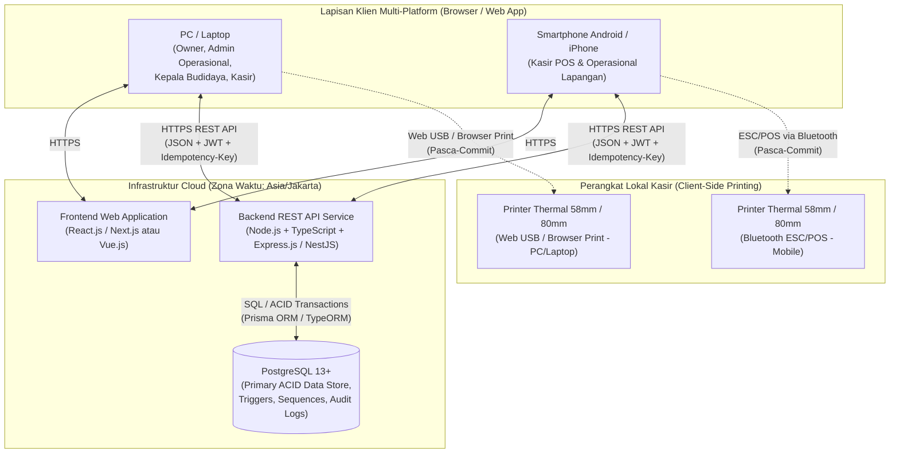
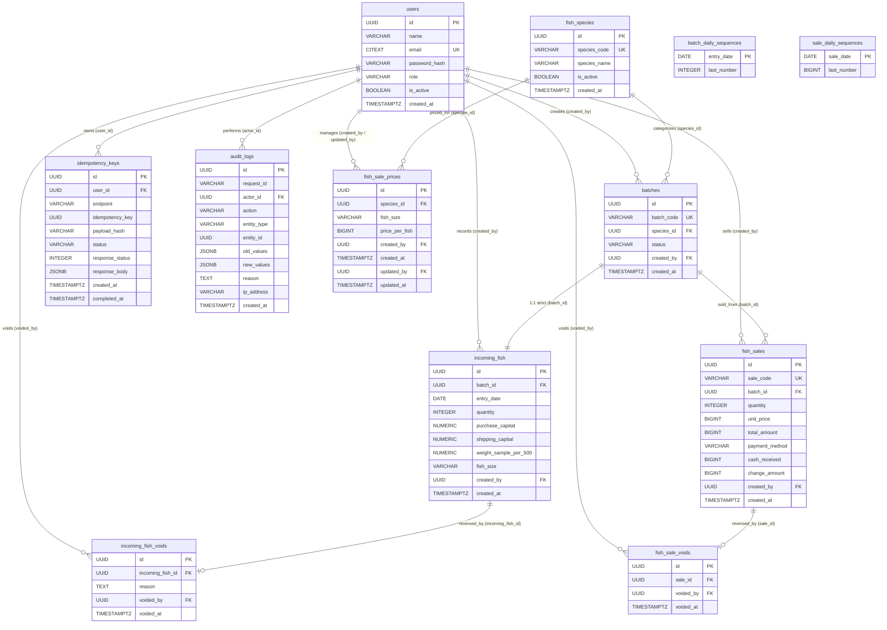
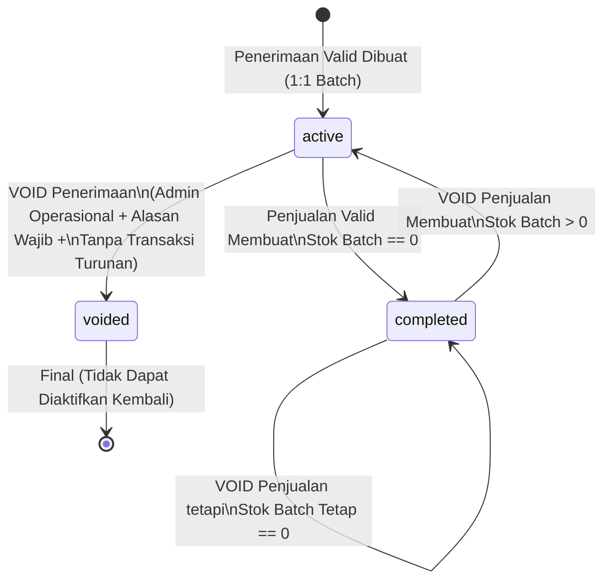
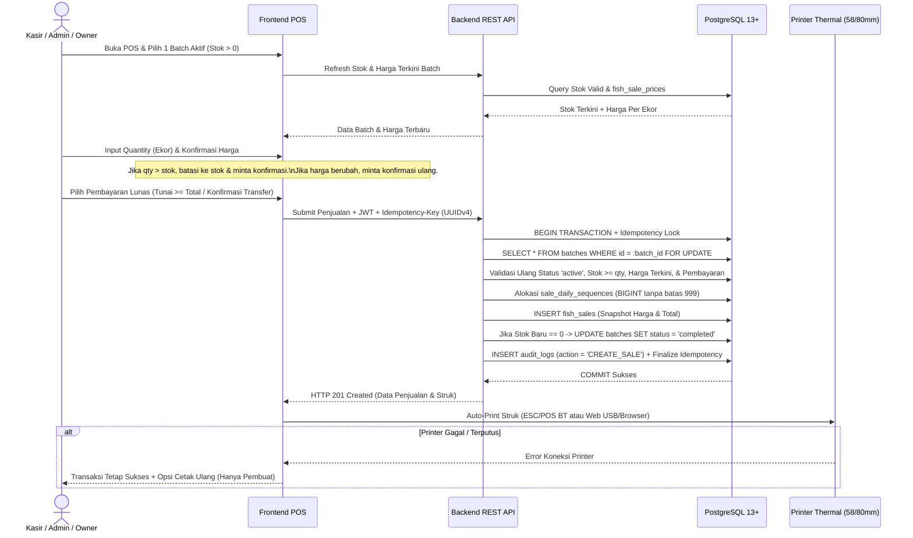

# DOKUMEN ARSITEKTUR SISTEM (SYSTEM ARCHITECTURE)
# Sistem Manajemen Operasional Pisciculture Farm Indonesia (PFI)

| Informasi | Nilai |
|---|---|
| Dokumen | `architecture.md` |
| Versi | 1.0 |
| Status | Baseline Arsitektur MVP (V4.5 Locked + Perluasan POS & Keputusan Pemilik Produk) |
| Produk | Sistem Manajemen Operasional Pisciculture Farm Indonesia (PFI) |
| Cakupan | Keseluruhan MVP: Penerimaan Ikan, Manajemen Batch, dan Ikan Keluar (Kasir/POS) |
| Zona Waktu Bisnis | `Asia/Jakarta` ($\text{UTC}+7$) |
| Basis Data Utama | PostgreSQL 13+ |
| Dokumen Acuan | `master_blueprint_api_contract_pfi_main.md`, `prd.md`, `implementation_plan.md`, `AGENTS.md`, `GEMINI.md` |

---

## 1. Tujuan dan Kedudukan Dokumen

Dokumen ini menjelaskan gambaran besar struktur sistem, arsitektur perangkat lunak, skema database dan relasi antar tabel, alur data transaksi, kontrol konkurensi dan keamanan, serta strategi integrasi perangkat untuk Sistem Manajemen Operasional **Pisciculture Farm Indonesia (PFI)**.

### 1.1 Hierarki Sumber Kebenaran

Apabila ditemukan perbedaan antar dokumen atau kode selama pengembangan, urutan otoritas yang berlaku adalah:

1. Keputusan bisnis dan teknis eksplisit terbaru dari pemilik produk.
2. Master Blueprint V4.5 untuk modul Penerimaan Ikan, Batch, dan VOID Penerimaan.
3. Keputusan bisnis yang dikonfirmasi pada perluasan modul Ikan Keluar (Kasir/POS).
4. `prd.md` untuk kebutuhan fungsional, halaman, alur pengguna, dan *acceptance criteria*.
5. `architecture.md` (dokumen ini) untuk struktur arsitektur, skema data, dan batas integrasi sistem.
6. `implementation_plan.md` untuk urutan fase pengerjaan dan gerbang persetujuan (*gates*).

### 1.2 Legenda Status Keputusan Arsitektur

Setiap komponen dalam dokumen ini membawa penanda status agar tim pengembang dan agen AI tidak mencampuradukkan kontrak yang sudah dikunci dengan rancangan yang masih menunggu finalisasi:

| Status | Makna | Aturan Implementasi |
|---|---|---|
| `LOCKED — V4.5` | Aturan arsitektur, skema, dan API Penerimaan/Batch/VOID V4.5 yang telah dikunci. | Wajib diimplementasikan persis sesuai spesifikasi. |
| `LOCKED — BUSINESS` | Aturan bisnis POS yang telah disetujui. | Perilaku bisnis tidak boleh diubah atau diasumsikan ulang. |
| `APPROVED — OWNER` | Keputusan arsitektur/skema yang ditetapkan pemilik produk pada sesi desain arsitektur. | Berlaku sebagai acuan desain sistem dan siap diturunkan ke kontrak teknis. |
| `PROPOSED — TECHNICAL` | Rekomendasi stack atau rancangan teknis yang masih bersifat kandidat. | Menunggu audit repository (`P0-01`) atau penguncian kontrak detail sebelum coding final. |
| `TBD — NEEDS DECISION` | Detail teknis yang sengaja dibiarkan terbuka hingga tahap pengujian/finalisasi kontrak. | Dilarang diisi dengan asumsi sepihak; wajib difinalisasi pada gerbang terkait. |
| `OUT OF SCOPE` | Fitur di luar cakupan MVP (akuntansi, CRM, modul kematian, pakan, payment gateway, dll.). | Tidak boleh dibangun pada fase ini. |

---

## 2. Gambaran Besar Struktur Sistem

### 2.1 Gaya Arsitektur dan Topologi Sistem

Sistem PFI menggunakan arsitektur **Decoupled Client-Server berbasis REST API** untuk mendukung akses multi-klien (Android, iPhone, PC, dan laptop) terhadap satu sumber kebenaran data terpusat.

### 2.2 Ketetapan dan Rekomendasi Technology Stack

Bagian ini memisahkan teknologi yang sudah dikunci secara mutlak dari stack rekomendasi yang ditetapkan untuk efisiensi pengembangan (`Task P0-02`):

| Lapisan | Teknologi / Spesifikasi | Status | Keterangan & Pertimbangan Arsitektur |
|---|---|---|---|
| **Database Engine** | PostgreSQL 13+ | `LOCKED — V4.5` | Sumber kebenaran tunggal dengan dukungan ACID, `SELECT ... FOR UPDATE`, *Deferred Constraint Trigger*, `JSONB`, dan *granular privileges*. |
| **Zona Waktu Bisnis** | `Asia/Jakarta` ($\text{UTC}+7$) | `LOCKED — V4.5` | Seluruh validasi tanggal penerimaan (`entry_date`) dan penomoran harian batch/penjualan mengacu pada tanggal $\text{UTC}+7$. |
| **Gaya Arsitektur** | Decoupled Frontend & Backend via REST API | `APPROVED — OWNER` | Memisahkan UI multi-perangkat dari logika bisnis dan otorisasi server. |
| **Backend Runtime & Framework** | Node.js + TypeScript + NestJS | `APPROVED — OWNER` (ADR 0001) | REST API modular; identitas dan RBAC tetap ditegakkan di backend. |
| **Frontend Framework** | Next.js App Router + React | `APPROVED — OWNER` (ADR 0001) | Client terpisah dari API; UI operasional mengikuti PRD dan skill UI/UX. |
| **Data Access / ORM** | Prisma ORM + parameterized raw SQL | `APPROVED — OWNER` (ADR 0001) | Gunakan transaksi interaktif/raw SQL berparameter untuk `SELECT ... FOR UPDATE`, sequence atomik, dan PostgreSQL triggers. |
| **Validation** | Zod + class-validator | `APPROVED — OWNER` (ADR 0001) | Skema lintas aplikasi berada di shared package; backend tetap memvalidasi boundary request. |
| **CSS & Components** | Tailwind CSS + shadcn/ui | `APPROVED — OWNER` (ADR 0001) | Komponen UI mengikuti sistem desain PFI dan tidak mengubah aturan domain. |
| **Test Framework** | Jest + Supertest | `APPROVED — OWNER` (ADR 0001) | Unit dan API integration tests; test database memakai PostgreSQL terpisah. |
| **Workspace** | npm workspaces (`apps/api`, `apps/web`, `packages/shared`) | `APPROVED — OWNER` (ADR 0001) | Tipe, RBAC enums, response envelope, dan skema Zod bersama di `packages/shared`. |
| **Migration Tool** | Prisma Migrate atau Golang Migrate | `APPROVED — OWNER` *(Opsi Rekomendasi)* | Harus mendukung eksekusi skrip DDL custom (constraint trigger, fungsi PL/pgSQL, dan `GRANT`/`REVOKE` granular). |
| **Infrastruktur & Hosting** | Cloud (Supabase, Render, Vercel, atau AWS) | `APPROVED — OWNER` *(Opsi Rekomendasi)* | Lingkungan server dan database wajib dikonfigurasi dengan timezone `Asia/Jakarta` dan penyimpanan timestamp bertipe `TIMESTAMPTZ`. |
| **Protokol Komunikasi** | HTTPS + REST JSON + JWT + `Idempotency-Key` ($\text{UUIDv4}$) | `LOCKED` / `APPROVED — OWNER` | Seluruh mutasi data (`POST`/`PATCH`/`PUT`) menggunakan header `Idempotency-Key` dan token JWT terverifikasi. |

### 2.3 Pemisahan Tanggung Jawab Lapisan (Layered Architecture)

Di dalam layanan Backend REST API, struktur kode dipisahkan menjadi empat lapisan tegas:

1. **Transport / HTTP Layer (Controller & Middleware):**
   - Memverifikasi token JWT, memeriksa status aktif akun (`is_active`), menegakkan RBAC per endpoint, memvalidasi format header `Idempotency-Key` ($\text{UUIDv4}$), dan memetakan respons JSON serta kode status HTTP.
2. **Validation & Normalization Layer:**
   - Memvalidasi skema payload, batas numerik, enum ukuran ikan, aturan tanggal `Asia/Jakarta`, serta melakukan normalisasi JSON dan perhitungan hash `SHA-256` untuk kebutuhan idempotency.
3. **Domain & Transaction Service Layer:**
   - Mengorkestrasi transaksi database ACID, penguncian baris batch (`SELECT ... FOR UPDATE`), alokasi sequence harian atomik, kalkulasi stok terkomputasi, pembuatan snapshot harga, dan penulisan `audit_logs` dalam satu unit kerja atomik.
4. **Persistence Layer (Database & PostgreSQL Guardrails):**
   - Menegakkan integritas tingkat lanjut melalui `CHECK` constraints, `UNIQUE` indexes, `FOREIGN KEY ... ON DELETE RESTRICT`, *Deferred Constraint Trigger* ($1:1$ batch-penerimaan), *Immutability Triggers*, dan pemisahan *Migration Role* vs *App Runtime Role*.

---

## 3. Arsitektur Keamanan, Autentikasi, dan Otorisasi

### 3.1 Autentikasi dan Identitas Aktor

* **Mekanisme Autentikasi (`FR-AUTH-01`):** Backend memverifikasi tanda tangan dan masa berlaku token JWT pada setiap endpoint terlindungi.
* **Otoritas Identitas (`NFR-SEC-01`):** Seluruh kolom pelaku (`created_by`, `voided_by`, `updated_by`, `actor_id`) diekstrak secara eksklusif dari *claims* JWT yang telah diverifikasi. Payload dari frontend tidak pernah dipercaya sebagai penentu identitas pengguna.
* **Status Akun (`FR-AUTH-02`):** Pengguna dengan `is_active = false` ditolak aksesnya pada setiap permintaan terautentikasi.
* **Kardinalitas Role (`FR-AUTH-03`):** Setiap pengguna memiliki tepat satu role pada cakupan MVP.

### 3.2 Matriks Otorisasi RBAC Gabungan (4 Role)

Sistem mengenali empat role utama: `Owner`, `Admin Operasional`, `Kepala Budidaya`, dan `Kasir`.

| Fitur / Operasi Sistem | `Owner` | `Admin Operasional` | `Kepala Budidaya` | `Kasir` | Status Aturan |
|---|:---:|:---:|:---:|:---:|---|
| **Melihat Data Penerimaan & Batch** | Diizinkan | Diizinkan | Diizinkan | Ditolak | `LOCKED — V4.5` |
| **Membuat Penerimaan Ikan (`POST`)** | Ditolak | Diizinkan | Diizinkan | Ditolak | `LOCKED — V4.5` |
| **Melakukan VOID Penerimaan (`POST`)** | Ditolak | Diizinkan | Ditolak | Ditolak | `LOCKED — V4.5` |
| **Mengelola Master Spesies (API/UI)** | Ditolak | Ditolak *(Via DB Seed)* | Ditolak | Ditolak | `LOCKED — V4.5` |
| **Melihat Laporan Audit Log** | Diizinkan (Semua) | Diizinkan (Semua) | Diizinkan *(Khusus Modul Penerimaan/Batch)* | **Ditolak (`Forbidden`)** | `LOCKED — V4.5` + `APPROVED — OWNER` (`TBD-07`) |
| **Mengakses Halaman Kasir / POS** | Diizinkan | Diizinkan | Ditolak | Diizinkan | `LOCKED — BUSINESS` |
| **Melihat Seluruh Transaksi Penjualan** | Diizinkan | Diizinkan | Ditolak | Diizinkan | `LOCKED — BUSINESS` |
| **Membuat Transaksi Penjualan** | Diizinkan | Diizinkan | Ditolak | Diizinkan | `LOCKED — BUSINESS` |
| **Melakukan VOID Penjualan (Utuh)** | Diizinkan | Diizinkan | Ditolak | Diizinkan | `LOCKED — BUSINESS` |
| **Menambah / Mengubah Daftar Harga** | Diizinkan | Diizinkan | Ditolak | Ditolak | `LOCKED — BUSINESS` |
| **Menghapus Daftar Harga** | Ditolak | Ditolak | Ditolak | Ditolak | `LOCKED — BUSINESS` |
| **Cetak Ulang Struk (Milik Sendiri, Non-VOID)** | Diizinkan | Diizinkan | Ditolak | Diizinkan | `LOCKED — BUSINESS` |
| **Cetak Ulang Struk (Milik Pengguna Lain)** | Ditolak | Ditolak | Ditolak | Ditolak | `LOCKED — BUSINESS` |

### 3.3 Keamanan Lapisan Database (Least Privilege & Immutability)

Arsitektur database memisahkan dua peran koneksi PostgreSQL:

1. **Migration Role (DDL):** Digunakan hanya saat deployment migrasi skema dan *seeding* awal (`CREATE`, `ALTER`, `DROP`, `TRIGGER`, `GRANT`).
2. **App Runtime Role (DML Granular):** Digunakan oleh layanan backend saat runtime dengan hak akses terbatas:
   * **Tabel Append-Only (`incoming_fish`, `incoming_fish_voids`, `audit_logs`, serta perluasan POS `fish_sales`, `fish_sale_voids`):** Hanya memiliki hak `SELECT` dan `INSERT`. Hak `UPDATE` dan `DELETE` dicabut secara mutlak.
   * **Proteksi Trigger:** Trigger `BEFORE UPDATE OR DELETE` dipasang pada seluruh tabel append-only untuk melemparkan `EXCEPTION` apabila ada upaya modifikasi atau penghapusan baris historis dari jalur koneksi mana pun.
    * **Tabel Sequence, Katalog Harga & Status Terkendali:** Sesuai keputusan eksplisit ADR 0001 untuk memenuhi alur atomik V4.5, `batch_daily_sequences` memiliki `SELECT`, `INSERT`, dan `UPDATE` terbatas pada kolom `last_number`; `batches` memiliki `SELECT`, `INSERT`, dan `UPDATE` terbatas pada kolom `status`. `idempotency_keys` hanya dapat di-`UPDATE` pada `status`, `response_status`, `response_body`, dan `completed_at`. Hak POS (`sale_daily_sequences`, `fish_sale_prices`, dan tabel transaksi POS) tetap tidak diterapkan sebelum Gate POS.

---

## 4. Arsitektur Database dan Skema Relasional

### 4.1 Entity Relationship Diagram (ERD)

Diagram berikut memetakan 8 tabel terkunci dari V4.5 bersama 4 tabel perluasan POS:

### 4.2 Skema Tabel Modul V4.5 (`LOCKED — V4.5` dengan Perluasan Role & Action)

#### 1. `users`
Menyimpan identitas pengguna dan role tunggal per akun.
* `id`: `UUID PRIMARY KEY DEFAULT gen_random_uuid()`
* `name`: `VARCHAR(255) NOT NULL`
* `email`: `CITEXT` / `VARCHAR(255) NOT NULL` dengan unique index `LOWER(email)`
* `password_hash`: `VARCHAR(255) NOT NULL`
* `role`: `VARCHAR(50) NOT NULL` — pada migrasi Fase 7 (`P7-01`), constraint `CHECK` V4.5 diperbarui melalui `ALTER TABLE users` agar menerima `'Owner'`, `'Admin Operasional'`, `'Kepala Budidaya'`, dan `'Kasir'` (`LOCKED — BUSINESS`).
* `is_active`: `BOOLEAN NOT NULL DEFAULT true`
* `created_at`: `TIMESTAMPTZ NOT NULL DEFAULT CURRENT_TIMESTAMP`

#### 2. `fish_species`
Master spesies ikan (diisi melalui migration seed: `LELE`, `PATIN`, `GURAME-MERAH`, `GURAME-HITAM`, `NILA-HITAM`, `NILA-MERAH`).
* `id`: `UUID PRIMARY KEY DEFAULT gen_random_uuid()`
* `species_code`: `VARCHAR(50) NOT NULL UNIQUE`
* `species_name`: `VARCHAR(100) NOT NULL`
* `is_active`: `BOOLEAN NOT NULL DEFAULT true`
* `created_at`: `TIMESTAMPTZ NOT NULL DEFAULT CURRENT_TIMESTAMP`

#### 3. `batch_daily_sequences`
Sequence harian atomik untuk kode batch berbasis `entry_date`.
* `entry_date`: `DATE PRIMARY KEY`
* `last_number`: `INTEGER NOT NULL CHECK (last_number BETWEEN 0 AND 999)`

#### 4. `batches`
Entitas induk kelompok ikan homogen (1 spesies, 1 ukuran).
* `id`: `UUID PRIMARY KEY DEFAULT gen_random_uuid()`
* `batch_code`: `VARCHAR(50) NOT NULL UNIQUE` (Format: `PFI-BCH-YYYYMMDD-XXX`)
* `species_id`: `UUID NOT NULL REFERENCES fish_species(id) ON DELETE RESTRICT`
* `status`: `VARCHAR(20) NOT NULL CHECK (status IN ('active', 'completed', 'voided'))`
* `created_by`: `UUID NOT NULL REFERENCES users(id) ON DELETE RESTRICT`
* `created_at`: `TIMESTAMPTZ NOT NULL DEFAULT CURRENT_TIMESTAMP`
* **Constraint Khusus:** *Deferred Constraint Trigger* (`INITIALLY DEFERRED`) memastikan setiap baris `batches` memiliki tepat satu baris `incoming_fish` saat transaksi `COMMIT`.

#### 5. `incoming_fish` *(Append-Only / Immutable)*
* `id`: `UUID PRIMARY KEY DEFAULT gen_random_uuid()`
* `batch_id`: `UUID NOT NULL UNIQUE REFERENCES batches(id) ON DELETE RESTRICT`
* `entry_date`: `DATE NOT NULL` (maksimal tanggal hari ini di `Asia/Jakarta`)
* `quantity`: `INTEGER NOT NULL CHECK (quantity BETWEEN 1 AND 1000000)`
* `purchase_capital`: `NUMERIC(18,2) NOT NULL CHECK (purchase_capital BETWEEN 0 AND 9999999999.00)` (tanpa default)
* `shipping_capital`: `NUMERIC(18,2) NOT NULL CHECK (shipping_capital BETWEEN 0 AND 9999999999.00)` (tanpa default)
* `weight_sample_per_500`: `NUMERIC(12,2) NULLABLE CHECK (weight_sample_per_500 IS NULL OR weight_sample_per_500 BETWEEN 0.01 AND 100000.00)`
* `fish_size`: `VARCHAR(20) NOT NULL CHECK (fish_size IN ('2-4 cm', '3-5 cm', '4-6 cm', '5-7 cm', '6-8 cm', '7-9 cm', '8-10 cm', '9-11 cm', '10-12 cm'))`
* `created_by`: `UUID NOT NULL REFERENCES users(id) ON DELETE RESTRICT`
* `created_at`: `TIMESTAMPTZ NOT NULL DEFAULT CURRENT_TIMESTAMP`

#### 6. `incoming_fish_voids` *(Append-Only / Immutable)*
* `id`: `UUID PRIMARY KEY DEFAULT gen_random_uuid()`
* `incoming_fish_id`: `UUID NOT NULL UNIQUE REFERENCES incoming_fish(id) ON DELETE RESTRICT`
* `reason`: `TEXT NOT NULL CHECK (reason <> '' AND TRIM(reason) <> '')`
* `voided_by`: `UUID NOT NULL REFERENCES users(id) ON DELETE RESTRICT`
* `voided_at`: `TIMESTAMPTZ NOT NULL DEFAULT CURRENT_TIMESTAMP`

#### 7. `idempotency_keys`
* `id`: `UUID PRIMARY KEY DEFAULT gen_random_uuid()`
* `user_id`: `UUID NOT NULL REFERENCES users(id) ON DELETE RESTRICT`
* `endpoint`: `VARCHAR(255) NOT NULL`
* `idempotency_key`: `UUID NOT NULL`
* `payload_hash`: `VARCHAR(64) NOT NULL` (SHA-256 dari payload bisnis ternormalisasi)
* `status`: `VARCHAR(20) NOT NULL CHECK (status IN ('processing', 'completed'))`
* `response_status`: `INTEGER NULLABLE`
* `response_body`: `JSONB NULLABLE`
* `created_at`: `TIMESTAMPTZ NOT NULL DEFAULT CURRENT_TIMESTAMP`
* `completed_at`: `TIMESTAMPTZ NULLABLE`
* **Unique Index:** `CREATE UNIQUE INDEX idx_idempotency_user_endpoint_key ON idempotency_keys (user_id, endpoint, idempotency_key);`

#### 8. `audit_logs` *(Append-Only / Immutable)*
* `id`: `UUID PRIMARY KEY DEFAULT gen_random_uuid()`
* `request_id`: `VARCHAR(255) NOT NULL`
* `actor_id`: `UUID NOT NULL REFERENCES users(id) ON DELETE RESTRICT`
* `action`: `VARCHAR(50) NOT NULL` — pada migrasi Fase 7, constraint `CHECK` V4.5 diperbarui melalui `ALTER TABLE audit_logs` agar mencakup nilai V4.5 (`'CREATE_ENTRY'`, `'VOID_ENTRY'`) dan nilai baru POS (`'CREATE_SALE'`, `'VOID_SALE'`, `'UPDATE_PRICE'`) (`APPROVED — OWNER`, `TBD-06`).
* `entity_type`: `VARCHAR(50) NOT NULL`
* `entity_id`: `UUID NOT NULL`
* `old_values`: `JSONB NULLABLE` *(Untuk `UPDATE_PRICE`, dibiarkan `NULL` sesuai keputusan audit ringkas `TBD-02`)*
* `new_values`: `JSONB NULLABLE` *(Untuk `UPDATE_PRICE`, dibiarkan `NULL` sesuai keputusan audit ringkas `TBD-02`)*
* `reason`: `TEXT NULLABLE`
* `ip_address`: `VARCHAR(45) NULLABLE`
* `created_at`: `TIMESTAMPTZ NOT NULL DEFAULT CURRENT_TIMESTAMP`

### 4.3 Skema Tabel Modul POS (Keputusan Pemilik Produk + Rancangan Teknis)

#### 9. `sale_daily_sequences` (`APPROVED — OWNER` — `TBD-05`)
Mengelola penomoran transaksi penjualan harian global tanpa batas maksimum $999$.
* `sale_date`: `DATE PRIMARY KEY` (berdasarkan tanggal transaksi pada zona waktu `Asia/Jakarta`)
* `last_number`: `BIGINT NOT NULL CHECK (last_number >= 0)`
* **Format Nomor Transaksi:** `PFI-SAL-YYYYMMDD-XXX`, dengan padding minimal 3 digit untuk angka $1\text{--}999$ (`001`--`999`) dan otomatis melebar untuk angka $\ge 1000$ (`1000`, `1001`, dst.).

#### 10. `fish_sale_prices` (`APPROVED — OWNER` untuk `TBD-01` & `TBD-02` | `PROPOSED — TECHNICAL` untuk DDL final)
Menyimpan satu harga jual aktif per kombinasi spesies dan ukuran ikan (mutable/dapat ditimpa oleh `Owner` dan `Admin Operasional`, tanpa riwayat harga katalog).
* `id`: `UUID PRIMARY KEY DEFAULT gen_random_uuid()`
* `species_id`: `UUID NOT NULL REFERENCES fish_species(id) ON DELETE RESTRICT`
* `fish_size`: `VARCHAR(20) NOT NULL` (menggunakan enum 9 ukuran standar V4.5)
* `price_per_fish`: `BIGINT NOT NULL CHECK (price_per_fish BETWEEN 1 AND 10000000)` (`APPROVED — OWNER` `TBD-01`) — menyimpan bilangan bulat Rupiah tanpa angka desimal sesuai aturan bisnis POS (`FR-PRICE-04`).
* `created_by`: `UUID NOT NULL REFERENCES users(id) ON DELETE RESTRICT`
* `created_at`: `TIMESTAMPTZ NOT NULL DEFAULT CURRENT_TIMESTAMP`
* `updated_by`: `UUID NOT NULL REFERENCES users(id) ON DELETE RESTRICT`
* `updated_at`: `TIMESTAMPTZ NOT NULL DEFAULT CURRENT_TIMESTAMP`
* **Constraint Unik:** `UNIQUE (species_id, fish_size)`
* **Kebijakan Audit (`TBD-02` — `APPROVED — OWNER`):** Setiap penambahan/perubahan harga dicatat ke `audit_logs` dengan `action = 'UPDATE_PRICE'` yang hanya menyimpan aktor (`actor_id`) dan waktu (`created_at`), tanpa menyimpan `old_values` maupun `new_values`.

#### 11. `fish_sales` (`PROPOSED — TECHNICAL` — Append-Only)
Menyimpan transaksi penjualan satu batch secara lunas beserta *snapshot* harga pada saat transaksi terjadi.
* `id`: `UUID PRIMARY KEY DEFAULT gen_random_uuid()`
* `sale_code`: `VARCHAR(50) NOT NULL UNIQUE` (Format: `PFI-SAL-YYYYMMDD-XXX`, identitas internal, tidak dicetak di struk)
* `batch_id`: `UUID NOT NULL REFERENCES batches(id) ON DELETE RESTRICT`
* `quantity`: `INTEGER NOT NULL CHECK (quantity > 0)` (satuan ekor)
* `unit_price`: `BIGINT NOT NULL CHECK (unit_price BETWEEN 1 AND 10000000)` (snapshot harga Rupiah bulat per ekor saat transaksi)
* `total_amount`: `BIGINT NOT NULL CHECK (total_amount = quantity::BIGINT * unit_price)` (snapshot total Rupiah bulat)
* `payment_method`: `VARCHAR(20) NOT NULL CHECK (payment_method IN ('cash', 'transfer'))`
* `cash_received`: `BIGINT NULLABLE` (wajib $\ge \text{total\_amount}$ untuk `cash`; `NULL` untuk `transfer`)
* `change_amount`: `BIGINT NULLABLE` ($= \text{cash\_received} - \text{total\_amount}$ untuk `cash`; `NULL` untuk `transfer`)
* `created_by`: `UUID NOT NULL REFERENCES users(id) ON DELETE RESTRICT`
* `created_at`: `TIMESTAMPTZ NOT NULL DEFAULT CURRENT_TIMESTAMP`

#### 12. `fish_sale_voids` (`PROPOSED — TECHNICAL` — Append-Only)
Menyimpan pembatalan satu transaksi penjualan secara utuh tanpa mengubah atau menghapus baris pada `fish_sales`.
* `id`: `UUID PRIMARY KEY DEFAULT gen_random_uuid()`
* `sale_id`: `UUID NOT NULL UNIQUE REFERENCES fish_sales(id) ON DELETE RESTRICT` (memastikan 1 transaksi hanya dapat di-VOID 1 kali)
* `voided_by`: `UUID NOT NULL REFERENCES users(id) ON DELETE RESTRICT`
* `voided_at`: `TIMESTAMPTZ NOT NULL DEFAULT CURRENT_TIMESTAMP`
* *(Catatan: Tidak memiliki kolom `reason` wajib sesuai keputusan bisnis POS).*

### 4.4 Model Kalkulasi Stok & Transisi Status Batch

Stok tidak pernah disimpan sebagai angka statis yang dapat diedit manual, melainkan dihitung dari transaksi valid:

$$\text{Stok Batch} = \text{Total Penerimaan Valid} - \text{Total Penjualan Valid} - \text{Total Kematian Valid}$$

* **Total Penerimaan Valid:** Nilai `incoming_fish.quantity` untuk batch yang tidak memiliki baris pada `incoming_fish_voids`.
* **Total Penjualan Valid:** $\sum \text{fish\_sales.quantity}$ pada batch terkait yang `sale_id`-nya tidak tercatat pada `fish_sale_voids`.
* **Total Kematian Valid:** Bernilai $0$ pada cakupan MVP saat ini karena modul pencatatan kematian berstatus `OUT OF SCOPE`, namun service kalkulasi stok didesain modular agar siap menyertakan pengurangan kematian valid pada fase berikutnya.

---

## 5. Alur Data dan Mekanisme Transaksi Atomik

### 5.1 Alur Penerimaan Ikan (`POST /api/v1/fish-entries` — `LOCKED — V4.5`)

1. **Auth & RBAC Check:** Validasi JWT, status aktif akun, dan role (`Admin Operasional` atau `Kepala Budidaya`).
2. **Validasi Input & Zona Waktu:** Validasi payload JSON, batas numerik, enum `fish_size`, serta `entry_date` $\le$ tanggal hari ini di `Asia/Jakarta`. Kegagalan pada tahap 1--2 mengembalikan HTTP `400`/`401`/`403`/`422` tanpa mengonsumsi `Idempotency-Key`.
3. **Normalisasi & SHA-256 Hash:** Hapus properti `null` secara rekursif, urutkan key objek secara alfabetis ($\text{A--Z}$), pangkas *trailing zeros* pada 3 field desimal (`purchase_capital`, `shipping_capital`, `weight_sample_per_500`), lalu hitung hash `SHA-256`.
4. **Begin Transaction & Idempotency Lock:** `INSERT` ke `idempotency_keys` (`status = 'processing'`). Jika konflik pada `(user_id, endpoint, idempotency_key)`:
   - Jika transaksi sebelumnya `completed` dengan `payload_hash` identik $\rightarrow$ kembalikan respons *cached*.
   - Jika `payload_hash` berbeda $\rightarrow$ tolak dengan HTTP `409 IDEMPOTENCY_MISMATCH`.
5. **Validasi Spesies Aktif:** Pastikan `species_id` ada di `fish_species` dengan `is_active = true` (jika tidak, rollback $\rightarrow$ `422 SPECIES_NOT_ACTIVE`).
6. **Alokasi Sequence Harian Atomik:** Jalankan `INSERT INTO batch_daily_sequences ... ON CONFLICT DO NOTHING` diikuti `UPDATE ... SET last_number = last_number + 1 WHERE entry_date = :entry_date AND last_number < 999 RETURNING last_number`. Jika $0$ baris ter-update $\rightarrow$ rollback dan kembalikan `422 BATCH_SEQUENCE_EXHAUSTED`.
7. **Insert Batch & Penerimaan:** Simpan ke `batches` (`status = 'active'`) dan `incoming_fish` dengan `created_by` dari JWT.
8. **Write Audit Log:** Simpan ke `audit_logs` dengan `action = 'CREATE_ENTRY'`.
9. **Finalize Idempotency & Commit:** Perbarui `idempotency_keys` ke `'completed'`, simpan `response_status` dan `response_body`, lalu `COMMIT` (memicu evaluasi *Deferred Constraint Trigger* relasi $1:1$).

### 5.2 Alur VOID Penerimaan (`POST /api/v1/fish-entries/{batch_id}/void` — `LOCKED — V4.5`)

1. **Auth & RBAC Check:** Pastikan role pengguna adalah `Admin Operasional`.
2. **Validasi Alasan & Idempotency Lock:** Pastikan `reason` tidak kosong, lalu mulai transaksi database dan kunci `idempotency_keys`.
3. **Master Row Locking:** Eksekusi `SELECT * FROM batches WHERE id = :batch_id FOR UPDATE`. Jika tidak ditemukan $\rightarrow$ `404 BATCH_NOT_FOUND`.
4. **Verifikasi Status:** Pastikan `batches.status = 'active'`. Jika tidak $\rightarrow$ `409 BATCH_NOT_ACTIVE`.
5. **Pengecekan Transaksi Turunan:** Pastikan batch belum memiliki record penjualan (`fish_sales`) maupun transaksi turunan lain. Jika ada $\rightarrow$ rollback dan kembalikan `409 HAS_DEPENDENT_TRANSACTIONS`.
6. **Insert Reversal & Update Status:** Simpan baris baru ke `incoming_fish_voids` (tanpa mengubah/menghapus `incoming_fish`), ubah `batches.status = 'voided'`, dan tulis `audit_logs` (`action = 'VOID_ENTRY'`).
7. **Finalize Idempotency & Commit:** Selesaikan `idempotency_keys` dan `COMMIT` transaksi.

### 5.3 Alur Transaksi Penjualan Kasir / POS (`LOCKED — BUSINESS` | Kontrak API `TBD-04`)

### 5.4 Alur VOID Penjualan & Pengelolaan Harga

* **VOID Penjualan (`LOCKED — BUSINESS`):**
  1. Role POS (`Owner`, `Admin Operasional`, atau `Kasir`) mengonfirmasi pembatalan utuh pada transaksi yang belum di-VOID (tanpa input alasan wajib).
  2. Backend memulai transaksi ACID dengan `Idempotency-Key`, mengunci baris batch terkait (`SELECT ... FOR UPDATE`), dan memverifikasi penjualan belum tercatat di `fish_sale_voids`.
  3. Backend menyisipkan reversal ke `fish_sale_voids` (`sale_id`, `voided_by`, `voided_at`) tanpa mengubah `fish_sales`.
  4. Backend menghitung ulang stok valid batch: jika stok kembali $> 0$ dan status batch sebelumnya `'completed'`, status batch dikembalikan menjadi `'active'` (batch `'voided'` tidak pernah diaktifkan kembali).
  5. Backend menulis `audit_logs` dengan `action = 'VOID_SALE'`, menyelesaikan idempotency, dan melakukan `COMMIT`.
* **Pengelolaan Harga (`APPROVED — OWNER` untuk `TBD-01` & `TBD-02`):**
  1. Hanya `Owner` dan `Admin Operasional` yang dapat menambah atau memperbarui harga per `(species_id, fish_size)` dengan nilai Rupiah bulat $1 \le \text{price\_per\_fish} \le 10.000.000$.
  2. Backend memperbarui `fish_sale_prices` dan menulis `audit_logs` dengan `action = 'UPDATE_PRICE'` yang hanya mencatat `actor_id` dan `created_at` (`old_values = NULL`, `new_values = NULL`).
  3. Perubahan harga tidak pernah memengaruhi kolom `unit_price` maupun `total_amount` pada transaksi lama di `fish_sales`.

---

## 6. Arsitektur Kontrak API

### 6.1 Endpoint Terkunci V4.5 (`LOCKED — V4.5`)

| Method | Endpoint | Hak Akses | Idempotency | Keterangan |
|---|---|---|---|---|
| `POST` | `/api/v1/fish-entries` | `Admin Operasional`, `Kepala Budidaya` | Wajib ($\text{UUIDv4}$) | Membuat batch baru dan penerimaan ikan secara atomik (`201 Created`). |
| `POST` | `/api/v1/fish-entries/{batch_id}/void` | `Admin Operasional` | Wajib ($\text{UUIDv4}$) | Membatalkan penerimaan dengan alasan wajib jika tanpa transaksi turunan (`200 OK`). |

* **Kode Error Standar V4.5:** `400 INVALID_PAYLOAD`, `400 INVALID_IDEMPOTENCY_KEY`, `401 UNAUTHORIZED`, `403 FORBIDDEN`, `404 BATCH_NOT_FOUND`, `409 IDEMPOTENCY_MISMATCH`, `409 BATCH_NOT_ACTIVE`, `409 HAS_DEPENDENT_TRANSACTIONS`, `422 SPECIES_NOT_ACTIVE`, `422 INVALID_ENTRY_DATE`, `422 BATCH_SEQUENCE_EXHAUSTED`, `429 RATE_LIMIT_EXCEEDED`, `500 INTERNAL_SERVER_ERROR`, `503 DATABASE_LOCK_TIMEOUT`, `503 DATABASE_UNAVAILABLE`.
* **Catatan Perilaku Idempotency & Konkurensi POS (`TBD-04`):** Karena verifikasi stok terkini dan kecocokan harga terbaru (`unit_price` klien vs `fish_sale_prices`) pada `POST /api/v1/fish-sales` dilakukan di dalam transaksi database setelah `SELECT ... FOR UPDATE`, penolakan konkurensi (misalnya `409 PRICE_CHANGED` atau `409 INSUFFICIENT_STOCK`) akan me-`ROLLBACK` transaksi termasuk baris `idempotency_keys`. Oleh karena itu, klien wajib membangkitkan `Idempotency-Key` UUIDv4 baru setelah kasir menyetujui harga terbaru atau penyesuaian jumlah.
* **Endpoint Baca Pendukung PRD (`PG-01`, `PG-02`, `PG-04`, `PG-06`):** Endpoint autentikasi login, daftar/detail penerimaan & batch, serta pembacaan `audit_logs` (khusus `Owner`, `Admin Operasional`, `Kepala Budidaya`) mengikuti pola REST JSON standar di bawah `/api/v1`.

### 6.2 Kandidat Endpoint Modul POS (`PROPOSED — TECHNICAL` | `TBD-04`)

Daftar endpoint berikut merupakan peta layanan konseptual untuk modul POS. Skema *request/response body*, aturan pagination, dan daftar *error code* spesifik kasir ditandai sebagai **`TBD-04`** untuk dikunci sebelum tahap coding POS dimulai:

| Method | Kandidat Endpoint | Hak Akses | Fungsi Konseptual |
|---|---|---|---|
| `GET` | `/api/v1/pos/batches` | `Owner`, `Admin Operasional`, `Kasir` | Mengambil daftar batch `active` dengan stok valid $> 0$ beserta harga jual jika tersedia. |
| `GET` | `/api/v1/pos/batches/{batch_id}` | `Owner`, `Admin Operasional`, `Kasir` | Memuat ulang stok terkini dan harga terbaru batch sebelum konfirmasi transaksi. |
| `GET` | `/api/v1/pos/prices` | `Owner`, `Admin Operasional`, `Kasir` | Membaca daftar harga aktif per spesies dan ukuran. |
| `POST` | `/api/v1/pos/prices` | `Owner`, `Admin Operasional` | Menambahkan harga baru untuk kombinasi `(species_id, fish_size)` yang belum ada (`Idempotency-Key` UUIDv4 wajib). |
| `PATCH` | `/api/v1/pos/prices/{price_id}` | `Owner`, `Admin Operasional` | Mengubah harga aktif yang sudah ada dan mencatat audit `UPDATE_PRICE` (`Idempotency-Key` UUIDv4 wajib). |
| `POST` | `/api/v1/fish-sales` | `Owner`, `Admin Operasional`, `Kasir` | Menyimpan transaksi penjualan lunas secara atomik (`Idempotency-Key` wajib). |
| `GET` | `/api/v1/fish-sales` | `Owner`, `Admin Operasional`, `Kasir` | Menampilkan seluruh histori transaksi penjualan. |
| `GET` | `/api/v1/fish-sales/{sale_id}` | `Owner`, `Admin Operasional`, `Kasir` | Menampilkan detail transaksi penjualan beserta status aktif/VOID. |
| `POST` | `/api/v1/fish-sales/{sale_id}/void` | `Owner`, `Admin Operasional`, `Kasir` | Membatalkan seluruh transaksi penjualan (`Idempotency-Key` wajib, tanpa alasan wajib). |
| `GET` | `/api/v1/fish-sales/{sale_id}/receipt` | Pembuat Transaksi (`created_by`) | Mengambil data struk untuk cetak ulang (ditolak jika bukan pembuat atau transaksi sudah VOID). |

---

## 7. Layanan Eksternal dan Integrasi Perangkat

### 7.1 Kebijakan API Pihak Ketiga Eksternal

* **Status:** **Tidak Ada Integrasi Eksternal (`OUT OF SCOPE`)**.
* Sistem PFI beroperasi secara mandiri tanpa ketergantungan pada API pihak ketiga seperti *payment gateway*, sistem akuntansi/ERP, layanan CRM, maupun layanan analitik eksternal.
* Pembayaran transfer pada kasir dicatat melalui mekanisme konfirmasi manual oleh kasir bahwa dana telah diterima tanpa integrasi mutasi bank otomatis maupun input nomor referensi wajib.

### 7.2 Arsitektur Pencetakan Struk Thermal (`TBD-03`)

Pencetakan struk dijalankan sepenuhnya pada **sisi klien (Client-Side Printing)** dengan prinsip **Decoupled Commit-and-Print**:

1. **Pemisahan Status Transaksi dan Printer (`FR-PRINT-04`):**
   - Transaksi penjualan di-`COMMIT` ke PostgreSQL terlebih dahulu sebelum perintah cetak dijalankan.
   - Kegagalan koneksi printer, kertas habis, atau *timeout* Bluetooth/USB **tidak pernah** membatalkan transaksi penjualan dan tidak boleh memicu pengiriman ulang request `POST /api/v1/fish-sales`.
2. **Jalur Koneksi Multi-Platform (`APPROVED — OWNER`):**
   - **Perangkat Mobile (Android & iPhone):** Menggunakan protokol standar **ESC/POS melalui koneksi Bluetooth** untuk berkomunikasi dengan printer thermal portable 58 mm / 80 mm.
   - **Perangkat Desktop (PC & Laptop):** Menggunakan **Web USB** atau mekanisme **Cetak Browser Web standar (*Web Print*)** dengan tata letak CSS thermal 58 mm dan 80 mm.
   - **Batasan Teknis iOS/iPhone & `TBD-03`:** Browser web standar pada iOS/iPhone (Safari maupun browser berbasis WebKit) **tidak mendukung *Web Bluetooth API* secara bawaan**. Oleh karena itu, dukungan cetak Bluetooth langsung dari perangkat iPhone memerlukan aplikasi *native wrapper* / *print bridge* lokal atau jalur cetak alternatif yang wajib diverifikasi secara fisik lintas OS (Android, iOS/iPhone, Windows/macOS/Linux) pada `Task GPOS-04` & `P9-03`.
3. **Konten Struk & Otorisasi Cetak Ulang (`FR-PRINT-01` s.d. `FR-PRINT-05`):**
   - Struk **hanya** mencetak 9 elemen: Nama Perusahaan (`Pisciculture Farm Indonesia`), Tanggal & Waktu, Spesies Ikan, Ukuran Ikan, Jumlah (`ekor`), Harga per Ekor, Total Pembayaran, Metode Pembayaran (`Tunai` / `Transfer`), dan Nama Kasir.
   - **Dilarang mencetak:** Nomor penjualan internal (`PFI-SAL-...`), kode batch (`PFI-BCH-...`), data pelanggan, referensi transfer, maupun status/alasan VOID.
   - **Otorisasi Cetak Ulang:** Hanya dapat dijalankan oleh akun pembuat transaksi (`fish_sales.created_by == jwt.user_id`) dan hanya apabila transaksi belum memiliki catatan di `fish_sale_voids`.

---

## 8. Non-Functional Requirements dan Target Kinerja

* **Performa Penerimaan (`NFR-PERF-01` — `LOCKED — V4.5`):** Minimal $95\%$ permintaan ($p95$) penyimpanan penerimaan ikan (`POST /api/v1/fish-entries`) harus memperoleh respons dalam waktu $\le 1,5\text{ detik}$ pada uji beban $50$ *concurrent requests* di lingkungan *staging* (spesifikasi minimal $2\text{ vCPU}$, $4\text{ GB RAM}$, dengan populasi database minimal $100.000$ *records*).
* **Kontrol Konkurensi (`NFR-TRANS-03`):** Penguncian tingkat baris (`SELECT ... FOR UPDATE`) pada tabel `batches` menjamin operasi penjualan bersamaan maupun persaingan antara VOID dan penjualan pada batch yang sama ter-serialisasi tanpa menyebabkan stok negatif (*overselling*).
* **Integritas Audit & Idempotency (`NFR-TRANS-01`, `NFR-TRANS-02`):** Kegagalan penulisan `audit_logs` memicu *rollback* penuh transaksi bisnis; pengiriman ulang request jaringan dengan `Idempotency-Key` ($\text{UUIDv4}$) dan payload identik mengembalikan respons tersimpan tanpa duplikasi data.

---

## 9. Pelacakan Keputusan Terbuka (`TBD`) dan Gerbang Implementasi

Tabel berikut merangkum seluruh item `TBD` dari PRD/Blueprint beserta status terkininya setelah keputusan arsitektur pemilik produk:

| ID | Topik | Status Terkini | Keputusan / Tindakan yang Diperlukan |
|---|---|---|---|
| `TBD-01` | Batas maksimum harga per ekor | `APPROVED — OWNER` | Ditetapkan minimum $\text{Rp } 1$ dan maksimum $\text{Rp } 10.000.000$ per ekor menggunakan `BIGINT` (bilangan bulat Rupiah tanpa desimal). |
| `TBD-02` | Audit perubahan daftar harga | `APPROVED — OWNER` | Dicatat ke `audit_logs` (`action = 'UPDATE_PRICE'`) hanya dengan aktor dan waktu (`old_values` & `new_values` kosong). |
| `TBD-03` | Spesifikasi printer thermal | `APPROVED — OWNER` *(Pendekatan)* / `TBD` *(Uji Perangkat)* | Pendekatan ESC/POS Bluetooth (mobile) & Web USB/Browser Print (PC/laptop) disetujui; merek tidak dikunci agar universal, namun uji fisik lintas perangkat tetap wajib pada `GPOS-04`. |
| `TBD-04` | Kontrak API POS final | `TBD — NEEDS DECISION` | Skema request/response body, kode error spesifik POS, dan konfirmasi harga tetap menunggu Gate POS. Default query pagination/filter dasar mengikuti keputusan ADR 0001; detail envelope API POS tetap menunggu kontrak final. |
| `TBD-05` | Sequence penjualan harian | `APPROVED — OWNER` | Tabel `sale_daily_sequences` dengan tipe `BIGINT` disetujui sebagai desain final tanpa batas $999$. |
| `TBD-06` | Audit action & privilege POS | `APPROVED — OWNER` *(Actions)* / `TBD` *(DDL/Privileges)* | Nilai `action` baru (`CREATE_SALE`, `VOID_SALE`, `UPDATE_PRICE`) disetujui; detail trigger dan `GRANT`/`REVOKE` runtime POS dikunci pada `GPOS-02`. |
| `TBD-07` | Hak Audit Log untuk Kasir | `APPROVED — OWNER` | Role `Kasir` dilarang (`Forbidden`) mengakses data maupun halaman Audit Log. |
| `TBD-08` | Pengelolaan & provisioning akun | `PARTIALLY RESOLVED — OWNER` (ADR 0001) | Akun awal `Owner` lokal diprovision melalui CLI idempoten dari `.env`, tanpa registrasi publik dan tanpa mengubah akun yang sudah ada. Deaktivasi, perubahan role, reset password, dan administrasi akun tetap `TBD — NEEDS DECISION`. |
| `TBD-09` | Pagination & filter daftar | `APPROVED — OWNER` (ADR 0001) | `page=1`, `limit=20`, maksimum `100`; filter `startDate`/`endDate` ISO 8601 pada timestamp utama dan `status` hanya untuk enum resmi; urutan terbaru dahulu (`DESC`). Search dan arbitrary sort tidak termasuk keputusan ini. |
| `TBD-09` | Filter, pencarian, & pagination daftar | `TBD — NEEDS DECISION` | Parameter filter, sorting, dan pagination untuk daftar batch dan daftar penjualan perlu dikunci sebelum implementasi endpoint daftar. |