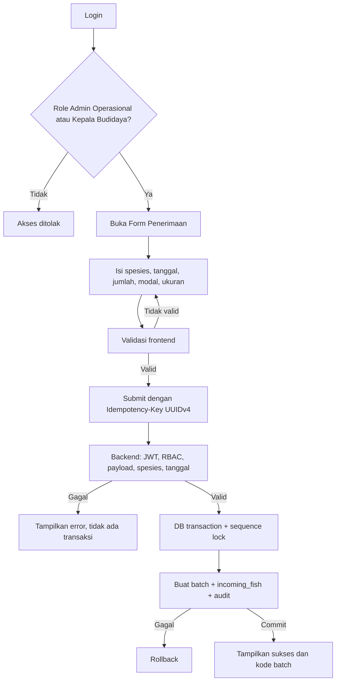
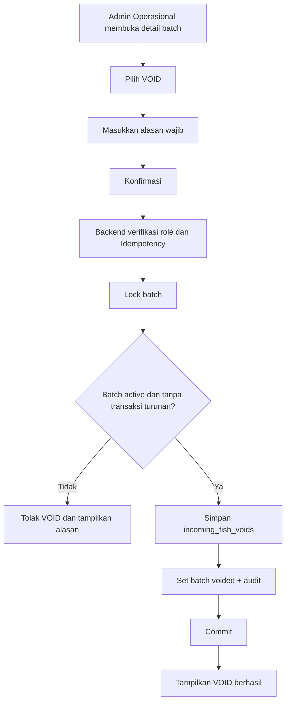
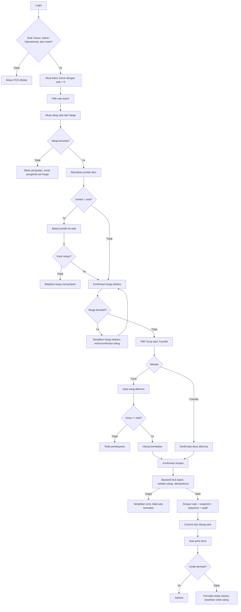
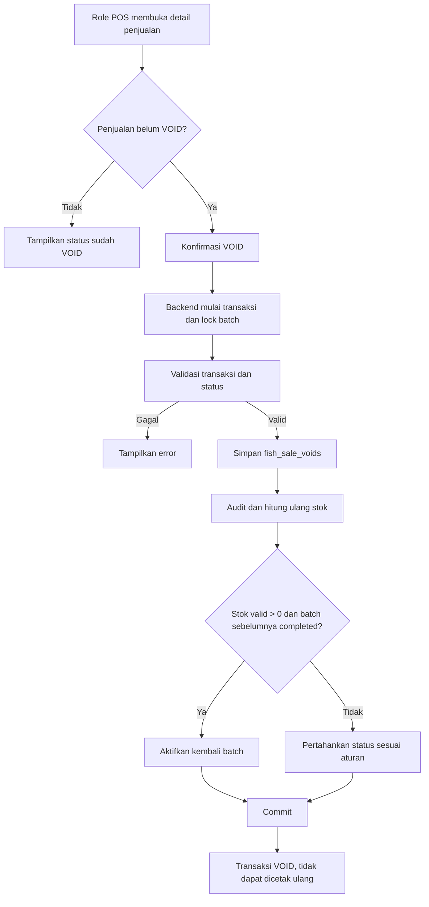

# PRODUCT REQUIREMENTS DOCUMENT (PRD)

# Sistem Manajemen Operasional Pisciculture Farm Indonesia (PFI)

| Informasi                          | Nilai                                                             |
| ---------------------------------- | ----------------------------------------------------------------- |
| Nama produk                        | Sistem Manajemen Operasional Pisciculture Farm Indonesia (PFI)    |
| Dokumen                            | Product Requirements Document (`prd.md`)                          |
| Versi PRD                          | 1.1                                                               |
| Status                             | Baseline V4.5 dengan addendum V4.6 pasca-MVP yang disetujui Owner |
| Bahasa                             | Indonesia                                                         |
| Zona waktu bisnis                  | `Asia/Jakarta` (UTC+7)                                            |
| Basis teknis yang telah ditetapkan | PostgreSQL 13+, autentikasi JWT, RBAC, ACID, idempotency UUIDv4   |
| Sumber utama                       | `master_blueprint_api_contract_pfi_main.md` dan `architecture.md` |

> **Kedudukan dokumen:** PRD ini menerjemahkan blueprint menjadi kebutuhan produk, halaman, perilaku pengguna, alur kerja, dan kondisi kegagalan. PRD tidak boleh digunakan untuk diam-diam mengubah keputusan bisnis atau kontrak teknis yang sudah dikunci pada Master Blueprint. Jika ditemukan konflik antara PRD dan blueprint, pekerjaan implementasi harus dihentikan pada bagian yang konflik dan meminta keputusan pemilik produk.

---

## 0. Cara membaca status requirement

Agar AI, desainer, developer, dan QA tidak menganggap semua rancangan memiliki tingkat kepastian yang sama, setiap kebutuhan dibaca dengan status berikut.

| Status                   | Makna                                                                                                                                                   |
| ------------------------ | ------------------------------------------------------------------------------------------------------------------------------------------------------- |
| **LOCKED — V4.5**        | Keputusan penerimaan ikan dan VOID pada Master Blueprint V4.5 yang telah disetujui untuk Sprint 1. Tidak boleh diubah tanpa persetujuan pemilik produk. |
| **LOCKED — BUSINESS**    | Keputusan bisnis POS yang telah dikonfirmasi pengguna. Perilaku bisnisnya tidak boleh ditebak atau diubah.                                              |
| **APPROVED — OWNER**     | Keputusan arsitektur atau teknis yang telah ditetapkan pemilik produk pada `architecture.md`. Siap dikunci ke kontrak teknis final.                     |
| **PROPOSED — TECHNICAL** | Rancangan teknis POS yang masih berupa usulan. Nama tabel, endpoint, payload, dan detail implementasi belum otomatis menjadi kontrak final.             |
| **TBD — NEEDS DECISION** | Detail yang belum diputuskan. AI/developer wajib menandainya dan tidak boleh mengarang nilai atau perilaku.                                             |
| **OUT OF SCOPE**         | Tidak dibangun pada ruang lingkup PRD/MVP ini.                                                                                                          |

### 0.1 Sumber keputusan

1. Modul Penerimaan Ikan dan VOID mengikuti keputusan **Master Blueprint V4.5**.
2. Modul Ikan Keluar (Kasir/POS) mengikuti keputusan bisnis pada Bagian II blueprint gabungan.
3. Rancangan teknis POS pada blueprint tetap berstatus usulan sampai detail yang tertunda dikunci.
4. PRD ini tidak menambah fitur bisnis yang tidak didukung oleh blueprint.
5. Semua nilai, enum, role, dan aturan yang disebut sebagai LOCKED harus dipertahankan secara konsisten pada desain UI, backend, database, dan QA.

Addendum V4.6 yang disetujui Owner di Bagian 2.4 dan 13.4 menambah scope pasca-MVP. Addendum tersebut tidak mengubah aturan penerimaan, siklus hidup batch, atau kontrak POS V4.5 sebelum implementasi V4.6 dirilis.

---

# 1. Ringkasan produk

## 1.1 Apa yang akan dibuat?

Pisciculture Farm Indonesia (PFI) akan menggunakan aplikasi internal untuk membantu pencatatan dan pengendalian operasional ikan berbasis batch. Ruang lingkup MVP yang dijelaskan PRD ini terdiri dari dua area utama:

1. **Penerimaan Ikan dan pengelolaan batch:** mencatat ikan masuk, membuat batch secara otomatis, melihat data penerimaan/batch, serta melakukan VOID penerimaan sesuai pembatasan V4.5.
2. **Ikan Keluar (Kasir/POS):** menjual ikan dari batch yang memiliki stok tersedia, menggunakan harga berdasarkan spesies dan ukuran, menerima pembayaran tunai atau transfer secara lunas, mencatat penjualan, melakukan VOID penjualan, dan mencetak struk thermal.

Aplikasi harus menjaga konsistensi jumlah ikan. Stok tidak boleh menjadi angka bebas yang dapat diedit pengguna. Nilai stok berasal dari transaksi penerimaan, penjualan, dan transaksi kematian yang valid sesuai modul yang sudah tersedia pada fase terkait.

## 1.2 Masalah yang ingin diselesaikan

Aplikasi ditujukan untuk mengurangi ketergantungan pada pencatatan terpisah dan mencegah kesalahan operasional yang dapat timbul ketika data penerimaan, batch, stok, harga, dan penjualan tidak terhubung.

Masalah yang secara langsung ditangani oleh MVP:

- Penerimaan ikan harus tercatat dengan identitas batch yang jelas.
- Satu transaksi penerimaan tidak boleh digabung dengan penerimaan lain ke dalam batch yang sama.
- Batch harus homogen: hanya satu spesies dan satu kategori ukuran.
- Pengguna harus dapat melihat data penerimaan dan batch sesuai hak akses.
- Penerimaan yang salah harus dapat dibatalkan melalui VOID tanpa menghapus data historis.
- Penjualan harus mengurangi stok batch secara benar dan tidak boleh menjual melebihi stok.
- Harga yang dipakai pada transaksi harus tersimpan sebagai snapshot agar perubahan daftar harga tidak mengubah transaksi lama.
- Penjualan harus dicatat sebagai transaksi lunas melalui Tunai atau Transfer.
- VOID penjualan harus memulihkan stok tanpa mengubah atau menghapus catatan penjualan asli.
- Kegagalan pencetakan struk tidak boleh membuat transaksi penjualan hilang atau dibuat dua kali.

## 1.3 Pernyataan visi produk

Menyediakan satu sistem pencatatan operasional PFI yang memiliki jejak transaksi, kontrol hak akses, perhitungan stok berbasis transaksi, dan proses penjualan yang konsisten dari penerimaan batch hingga ikan terjual.

## 1.4 Hasil yang diharapkan

| Hasil                                           | Indikator keberhasilan                                                                            |
| ----------------------------------------------- | ------------------------------------------------------------------------------------------------- |
| Penerimaan tercatat konsisten                   | Setiap penerimaan valid menghasilkan tepat satu batch dan tepat satu record penerimaan.           |
| Data historis terlindungi                       | Penerimaan, VOID, penjualan, dan audit tidak dihapus atau ditimpa setelah commit.                 |
| Stok akurat                                     | Penjualan tidak membuat stok negatif; stok 0 menutup batch; VOID penjualan menghitung ulang stok. |
| Penjualan terkendali                            | Penjualan hanya dari batch aktif dengan stok > 0 dan harga tersedia.                              |
| Harga transaksi konsisten                       | Harga satuan dan total transaksi tersimpan sebagai snapshot.                                      |
| Pembayaran tervalidasi                          | Hanya pembayaran lunas melalui Tunai atau Transfer yang dapat disimpan.                           |
| Operasional kasir tidak bergantung pada printer | Transaksi tetap berhasil tersimpan meskipun pencetakan gagal.                                     |
| Keamanan berbasis peran                         | Pengguna hanya dapat mengakses fungsi sesuai role dan aturan kepemilikan cetak ulang.             |

---

# 2. Tujuan, non-tujuan, dan ruang lingkup

## 2.1 Tujuan produk

1. Membuat proses pencatatan penerimaan ikan yang tervalidasi dan dapat diaudit.
2. Menjaga relasi penerimaan dan batch dengan aturan 1:1.
3. Menyediakan tampilan daftar penerimaan dan batch bagi role yang berwenang.
4. Menyediakan mekanisme VOID penerimaan sesuai aturan V4.5.
5. Menyediakan POS penjualan ikan dalam satuan ekor dan satu batch per transaksi.
6. Mengendalikan stok, harga, pembayaran, VOID penjualan, dan pencetakan struk.
7. Menerapkan autentikasi, otorisasi, idempotency, locking, dan transaksi atomik.
8. Menyediakan perilaku error yang jelas agar pengguna tidak perlu menebak apakah transaksi telah tersimpan.

## 2.2 Termasuk dalam MVP pada PRD ini

### A. Fondasi aplikasi

- Login dan pemeriksaan status akun.
- Otorisasi berdasarkan satu role per pengguna.
- Penerapan zona waktu bisnis `Asia/Jakarta`.
- Validasi di frontend, backend, dan database.
- Audit log untuk tindakan transaksi.
- Pengendalian idempotency untuk mutasi yang diwajibkan blueprint.

### B. Penerimaan ikan dan batch

- Melihat data penerimaan dan batch.
- Membuat penerimaan ikan.
- Membuat satu batch baru secara otomatis untuk setiap penerimaan valid.
- Menampilkan status batch dan informasi penerimaan yang relevan.
- VOID penerimaan oleh role yang diizinkan, dengan alasan wajib, dan hanya jika tidak ada transaksi turunan.

### C. Ikan Keluar (Kasir/POS)

- Melihat batch yang dapat dijual.
- Melihat dan memuat ulang stok serta harga terbaru.
- Mengelola daftar harga oleh Owner dan Admin Operasional.
- Membuat transaksi penjualan untuk satu batch.
- Pembayaran lunas Tunai atau Transfer.
- Menyimpan snapshot harga dan nilai transaksi.
- Melihat seluruh transaksi penjualan untuk role POS.
- VOID satu transaksi penjualan secara keseluruhan.
- Cetak otomatis dan cetak ulang struk sesuai otorisasi.
- Layout struk untuk kertas 58 mm dan 80 mm.

## 2.3 Tidak termasuk dalam MVP ini

Fitur berikut tidak boleh dibuat sebagai bagian dari ruang lingkup ini tanpa keputusan dan dokumen tambahan:

- Pencatatan kematian ikan sebagai modul UI tersendiri.
- Penggunaan pakan dan stok pakan.
- Pengadaan/pembelian pakan.
- Biaya operasional batch atau biaya umum.
- Arus kas dan laporan akuntansi.
- Laporan laba/rugi atau profit per batch.
- Pengiriman gabungan (`shipments`).
- CRM atau data pelanggan.
- Penjualan berdasarkan kilogram atau satuan selain ekor.
- Satu struk berisi lebih dari satu batch.
- Pembayaran sebagian, utang/piutang, cicilan, atau termin.
- Nomor referensi transfer.
- Diskon, pajak, kupon, dan promosi.
- Penghapusan transaksi.
- VOID sebagian dari transaksi penjualan.
- Cetak ulang struk transaksi yang sudah di-VOID.
- Integrasi printer tertentu sebelum perangkat aktual dipilih dan diuji.
- Pengelolaan master spesies melalui UI/API operasional; V4.5 menyatakan pengelolaan master spesies berada di luar MVP dan melalui seeding database.

**Catatan stok:** rumus stok V4.5 menyertakan pengurangan kematian valid. Modul kematian sendiri berada di fase selanjutnya. PRD ini tidak mendefinisikan halaman atau alur input kematian; integrasi transaksi kematian harus mengikuti spesifikasi modul fase berikutnya.

---

## 2.4 Addendum V4.6 — Katalog Multi-Produk dan Kesiapan Jual

Status: `APPROVED — OWNER`, pasca-MVP. Persyaratan ini menambah kemampuan POS tanpa mengubah kontrak penerimaan V4.5 atau siklus hidup batch.

### Gerbang kesiapan jual

- `batches.status` dan transisi V4.5 tetap `active`, `completed`, dan `voided`; trigger yang mengatur siklus hidup tersebut tidak berubah.
- Tambahkan `sale_readiness` terpisah dengan nilai `BELUM_SIAP` (default untuk batch baru dan batch lama) atau `SIAP_JUAL`.
- Batch hanya tersedia untuk penjualan bila `status = 'active'` dan `sale_readiness = 'SIAP_JUAL'`. Stok jual batch tetap dihitung dari transaksi valid, bukan disimpan sebagai angka manual.
- Hanya `Kepala Budidaya` dan `Owner` yang boleh mengubah kesiapan ke atau dari `SIAP_JUAL`. Setiap perubahan harus atomik dengan penambahan baris `batch_sale_readiness_histories`; nilai asal boleh NULL untuk inisialisasi yang dicatat secara eksplisit.
- Riwayat mencatat UUID, batch, kesiapan asal nullable, kesiapan tujuan, aktor, catatan lapangan nullable, dan waktu `TIMESTAMPTZ`. Riwayat bersifat append-only.

### Katalog multi-produk POS

- Tambahkan kategori produk dinamis, termasuk kategori awal yang dapat mencakup Benih Ikan, Ikan Konsumsi, Pakan & Nutrisi, Obat & Probiotik, serta Sarana Budidaya.
- Katalog dikelola Owner dan role `Admin Operasional` yang menjadi pemetaan role yang sudah ada untuk istilah Admin; V4.6 tidak menambah role baru.
- Produk memiliki SKU unik, nama, kategori, mode `BATCH_TRACKED` atau `NON_BATCH`, unit, harga aktif, dan status arsip `is_active`.
- Harga katalog memakai `NUMERIC(12,2)`, harus lebih dari nol dan tidak melebihi Rp10.000.000,00.
- Produk `BATCH_TRACKED` dipetakan ke spesies dan ukuran. Stok tampilannya merupakan agregasi stok dari batch aktif yang siap dijual; kasir tetap memilih satu `batch_id` tertentu ketika checkout.
- Produk `NON_BATCH` menggunakan stok produk langsung dan transaksi penjualannya tidak memiliki `batch_id`. Satuan produk mengikuti katalog.
- Perubahan kategori/produk dan perubahan kesiapan jual wajib mengikuti autentikasi JWT, RBAC backend, transaksi ACID, serta kebijakan audit append-only. Nama action audit khusus katalog dan kesiapan jual harus dikunci dalam P8-02 sebelum endpoint diterapkan.

### Kompatibilitas transaksi dan struk

- `fish_sales` tetap append-only serta mempertahankan `sale_daily_sequences` dan sembilan field resmi struk V4.5.
- Tambahkan relasi `product_id`; baris historis yang sudah ada tetap valid dengan `product_id = NULL`. Penjualan baru wajib mereferensikan produk aktif.
- `batch_id` menjadi nullable untuk mengakomodasi penjualan `NON_BATCH`. Baris penjualan `BATCH_TRACKED` wajib memiliki batch; baris `NON_BATCH` wajib memiliki `batch_id = NULL`.
- Pembuatan penjualan katalog menggunakan `POST /api/v1/sales`, idempotency UUIDv4, dan transaksi database. Untuk produk `BATCH_TRACKED`, backend wajib mengunci batch dengan `SELECT ... FOR UPDATE`, lalu memvalidasi ulang status aktif, `sale_readiness = 'SIAP_JUAL'`, stok, harga, dan pembayaran sebelum commit.
- Field struk tetap sembilan. Pemetaan identitas produk `NON_BATCH` ke slot spesies/ukuran pada struk serta dampak harga desimal ke snapshot pembayaran harus dikunci sebagai bagian kontrak P8-02; jangan menambah field struk atau membulatkan nilai diam-diam.

# 3. Pengguna sasaran dan peran

Aplikasi digunakan oleh personel internal PFI. Akses ditentukan oleh role yang melekat pada akun. Pada MVP, satu pengguna hanya mempunyai satu role.

## 3.1 Daftar role

| Role                  | Gambaran pengguna                      | Kebutuhan utama                                                                                                                                            |
| --------------------- | -------------------------------------- | ---------------------------------------------------------------------------------------------------------------------------------------------------------- |
| **Owner**             | Pemilik/pengelola usaha                | Memantau data penerimaan/audit; membuat dan VOID penerimaan; serta menggunakan seluruh fitur POS yang disetujui.                                           |
| **Admin Operasional** | Pengelola operasional dan administrasi | Mencatat penerimaan, mengelola harga, menangani VOID penerimaan, serta menjalankan dan mengawasi transaksi POS.                                            |
| **Kepala Budidaya**   | Penanggung jawab kegiatan budidaya     | Melihat penerimaan/batch, membuat pencatatan penerimaan, dan melihat audit log. Tidak mengakses POS.                                                       |
| **Kasir**             | Petugas transaksi penjualan            | Mengakses POS, menjual ikan, melihat seluruh penjualan, melakukan VOID penjualan, dan mencetak ulang transaksi yang dibuat sendiri. Tidak mengelola harga. |

## 3.2 Matriks akses gabungan

| Fitur                                           |        Owner | Admin Operasional |                Kepala Budidaya |                                Kasir |
| ----------------------------------------------- | -----------: | ----------------: | -----------------------------: | -----------------------------------: |
| Melihat data penerimaan dan batch               |           Ya |                Ya |                             Ya |           Tidak (`APPROVED — OWNER`) |
| Melihat audit log                               | Ya _(Semua)_ |      Ya _(Semua)_ | Ya _(Khusus Penerimaan/Batch)_ | Tidak (`APPROVED — OWNER`, `TBD-07`) |
| Membuat penerimaan ikan                         |           Ya |                Ya |                             Ya |                                Tidak |
| VOID penerimaan ikan                            |           Ya |                Ya |                          Tidak |                                Tidak |
| Mengakses halaman POS                           |           Ya |                Ya |                          Tidak |                                   Ya |
| Melihat seluruh transaksi penjualan             |           Ya |                Ya |                          Tidak |                                   Ya |
| Membuat transaksi penjualan                     |           Ya |                Ya |                          Tidak |                                   Ya |
| VOID penjualan                                  |           Ya |                Ya |                          Tidak |                                   Ya |
| Menambah/mengubah daftar harga                  |           Ya |                Ya |                          Tidak |                                Tidak |
| Cetak ulang transaksi yang dibuat sendiri       |           Ya |                Ya |                          Tidak |                                   Ya |
| Cetak ulang transaksi yang dibuat pengguna lain |        Tidak |             Tidak |                          Tidak |                                Tidak |

**Batasan interpretasi:** hak akses yang tidak disebutkan untuk suatu role tidak boleh dianggap otomatis diizinkan. Matriks ini harus diwujudkan konsisten pada frontend dan backend. Backend merupakan pengaman otorisasi utama.

## 3.3 Aturan identitas pengguna

- Login menggunakan akun yang terdaftar dan aktif.
- Autentikasi menggunakan JWT terverifikasi.
- Identitas pembuat transaksi (`created_by`), pelaku VOID (`voided_by`), dan aktor audit harus berasal dari claims JWT.
- Frontend tidak boleh menentukan atau mengirim identitas pelaku sebagai sumber kebenaran.
- Akun nonaktif tidak dapat menjalankan operasi yang membutuhkan autentikasi aktif.

---

# 4. Prinsip produk dan aturan domain yang tidak boleh dilanggar

Aturan berikut merupakan fondasi seluruh UI, API, database, dan QA.

## 4.1 Batch dan penerimaan

1. Setiap satu transaksi penerimaan ikan fisik menghasilkan tepat satu batch baru.
2. Satu batch memiliki tepat satu record penerimaan (`incoming_fish`).
3. Satu batch hanya berisi satu spesies dan satu kategori ukuran.
4. Pengiriman yang mengandung beberapa spesies atau ukuran harus dicatat sebagai transaksi penerimaan terpisah.
5. Batch baru dimulai dengan status `active`.
6. Kode batch menggunakan format `PFI-BCH-YYYYMMDD-XXX`.
7. Tanggal kode batch menggunakan `entry_date`, yaitu tanggal penerimaan aktual, bukan tanggal input.
8. Sequence batch V4.5 memiliki batas harian 999 (`001`–`999`); jika habis, penerimaan baru ditolak.
9. Kode batch yang telah dialokasikan tidak digunakan ulang setelah penerimaan berhasil dibuat, termasuk jika kemudian di-VOID.

## 4.2 Stok terkomputasi

Rumus domain:

`Stok Batch = Total Penerimaan Valid - Total Penjualan Valid - Total Kematian Valid`

- Transaksi VOID tidak dihitung dalam kalkulasi stok.
- Stok bukan kolom bebas yang dapat diedit manual.
- Penjualan valid adalah transaksi penjualan yang belum memiliki record VOID.
- Penjualan tidak boleh membuat stok negatif.
- Stok 0 menyebabkan batch berstatus `completed`.
- Batch berstatus `voided` tidak boleh dipilih untuk penjualan.
- Batch `completed` dapat kembali menjadi `active` jika VOID penjualan membuat stok validnya kembali lebih dari 0.
- VOID penjualan tidak boleh mengaktifkan kembali batch yang status asalnya `voided`.

## 4.3 Imutabilitas dan reversal

- Record penerimaan yang sudah commit tidak boleh diubah atau dihapus.
- VOID penerimaan dicatat pada tabel reversal terpisah dan membutuhkan alasan.
- Record penjualan yang sudah commit tidak boleh diubah atau dihapus.
- VOID penjualan dicatat pada record terpisah dan tidak membutuhkan alasan.
- Audit log bersifat append-only.
- Tidak ada tombol hapus untuk transaksi penerimaan, penjualan, atau VOID.

## 4.4 Aturan waktu

- Zona waktu bisnis adalah `Asia/Jakarta`.
- `entry_date` tidak boleh lebih besar dari tanggal saat ini di zona waktu `Asia/Jakarta`.
- Nomor batch dan penjualan menggunakan tanggal bisnis yang sesuai aturan masing-masing.
- Timestamp transaksi disimpan dengan tipe waktu yang mempertahankan zona waktu (`TIMESTAMPTZ` pada rancangan V4.5).

---

# 5. Struktur informasi dan halaman aplikasi

Bagian ini mendefinisikan halaman minimum yang dibutuhkan agar requirement produk dapat digunakan. Penamaan menu dapat disesuaikan pada desain UI, tetapi fungsi dan pembatasan akses tidak boleh berubah.

## 5.1 Peta halaman

| ID    | Halaman                 | Pengguna                                  | Tujuan                                                                           |
| ----- | ----------------------- | ----------------------------------------- | -------------------------------------------------------------------------------- |
| PG-01 | Login                   | Semua pengguna terdaftar                  | Mengautentikasi akun dan mengarahkan pengguna berdasarkan hak akses.             |
| PG-02 | Daftar Penerimaan/Batch | Owner, Admin Operasional, Kepala Budidaya | Melihat penerimaan dan batch beserta statusnya.                                  |
| PG-03 | Form Penerimaan Ikan    | Admin Operasional, Kepala Budidaya        | Membuat penerimaan dan batch baru.                                               |
| PG-04 | Detail Batch/Penerimaan | Owner, Admin Operasional, Kepala Budidaya | Melihat detail penerimaan dan status batch; menampilkan aksi sesuai role/status. |
| PG-05 | VOID Penerimaan         | Admin Operasional                         | Membatalkan penerimaan yang memenuhi aturan V4.5.                                |
| PG-06 | Audit Log               | Owner, Admin Operasional, Kepala Budidaya | Melihat jejak tindakan yang dicatat sistem.                                      |
| PG-07 | POS / Kasir             | Owner, Admin Operasional, Kasir           | Memilih batch, jumlah, harga, dan pembayaran untuk penjualan.                    |
| PG-08 | Daftar Harga            | Owner, Admin Operasional                  | Melihat dan mengelola harga spesies + ukuran.                                    |
| PG-09 | Daftar Penjualan        | Owner, Admin Operasional, Kasir           | Melihat seluruh transaksi penjualan.                                             |
| PG-10 | Detail Penjualan        | Owner, Admin Operasional, Kasir           | Melihat detail transaksi dan menampilkan aksi VOID/cetak ulang sesuai aturan.    |
| PG-11 | Struk / Dialog Cetak    | Pembuat transaksi yang berhak             | Menjalankan cetak otomatis atau cetak ulang tanpa membuat transaksi baru.        |

Tidak ada kebutuhan dashboard analitik, laporan laba/rugi, laporan arus kas, modul pakan, atau modul kematian yang ditetapkan pada sumber blueprint ini.

---

# 6. Kebutuhan halaman dan perilaku UI

## 6.1 PG-01 — Login

### Tujuan

Memastikan hanya akun terdaftar dan aktif yang dapat masuk ke aplikasi.

### Elemen minimum

- Input email.
- Input kata sandi.
- Tombol masuk.
- Informasi kesalahan autentikasi yang tidak membocorkan detail sensitif.

### Perilaku

1. Pengguna mengisi kredensial.
2. Sistem memvalidasi kredensial ke backend.
3. Jika valid dan akun aktif, sistem menerbitkan/menggunakan sesi autentikasi berbasis JWT sesuai implementasi.
4. Halaman/menu yang tersedia ditentukan berdasarkan role.
5. Jika akun tidak aktif, token tidak valid, atau kredensial salah, akses ditolak.

### Kondisi gagal

- Field kosong/tidak valid: tampilkan validasi tanpa memanggil operasi bisnis.
- Kredensial salah: tampilkan pesan login gagal.
- Token hilang/kedaluwarsa/tidak sah: minta pengguna login kembali.
- Akun nonaktif: tolak akses.
- Backend/database tidak tersedia: tampilkan kegagalan layanan tanpa berpura-pura login berhasil.

**TBD:** metode reset kata sandi, registrasi pengguna, dan pengelolaan akun tidak dijelaskan dalam blueprint ini.

## 6.2 PG-02 — Daftar Penerimaan/Batch

### Tujuan

Memberi akses untuk melihat penerimaan dan batch sesuai matriks role.

### Informasi minimum yang perlu disajikan

- Kode batch.
- Spesies ikan.
- Ukuran ikan.
- Tanggal penerimaan.
- Jumlah awal (ekor).
- Modal pembelian.
- Modal pengiriman.
- Sampel berat per 500 ekor jika tersedia.
- Status batch (`active`, `completed`, `voided`).
- Waktu pencatatan dan pengguna pembuat jika data tersedia dari API.

### Perilaku

- Owner, Admin Operasional, dan Kepala Budidaya dapat melihat data.
- Pengguna dapat membuka detail batch.
- Aksi buat penerimaan hanya muncul untuk Owner, Admin Operasional, dan Kepala Budidaya.
- Aksi VOID penerimaan hanya muncul untuk Owner dan Admin Operasional ketika batch memenuhi syarat.
- Nilai stok aktual tidak boleh disajikan sebagai angka manual yang dapat diedit. Integrasi tampilan stok harus menggunakan perhitungan transaksi valid setelah layanan stok tersedia.

### Kondisi gagal

- Pengguna tidak punya akses: tampilkan penolakan akses.
- Data gagal dimuat: tampilkan pesan gagal dan aksi muat ulang.
- Tidak ada data: tampilkan empty state, bukan error.
- Kegagalan jaringan: pertahankan konteks filter/halaman selama memungkinkan dan jangan membuat data lokal seolah-olah sudah tersimpan.

## 6.3 PG-03 — Form Penerimaan Ikan

### Tujuan

Mencatat ikan masuk dan membentuk satu batch baru secara otomatis.

### Pengguna yang berwenang

- Owner.
- Admin Operasional.
- Kepala Budidaya.

### Field form

| Field                   | Wajib | Aturan                                                                            |
| ----------------------- | ----: | --------------------------------------------------------------------------------- |
| `species_id`            |    Ya | Harus merujuk spesies aktif pada `fish_species`.                                  |
| `entry_date`            |    Ya | Format `YYYY-MM-DD`; tidak boleh melewati tanggal hari ini `Asia/Jakarta`.        |
| `quantity`              |    Ya | Integer, minimal 1 dan maksimal 1.000.000 ekor.                                   |
| `purchase_capital`      |    Ya | Rupiah desimal, 0,00 sampai 9.999.999.999,00; tidak boleh otomatis diisi default. |
| `shipping_capital`      |    Ya | Rupiah desimal, 0,00 sampai 9.999.999.999,00; tidak boleh otomatis diisi default. |
| `weight_sample_per_500` | Tidak | Gram per 500 ekor; jika diisi 0,01 sampai 100.000,00 gram.                        |
| `fish_size`             |    Ya | Harus dipilih dari daftar ukuran resmi.                                           |

### Daftar ukuran resmi

- `2-4 cm`
- `3-5 cm`
- `4-6 cm`
- `5-7 cm`
- `6-8 cm`
- `7-9 cm`
- `8-10 cm`
- `9-11 cm`
- `10-12 cm`

### Alur

1. Pengguna membuka form.
2. Sistem menampilkan pilihan spesies aktif dan daftar ukuran resmi.
3. Pengguna memasukkan tanggal, jumlah, modal pembelian, modal pengiriman, serta sampel berat opsional.
4. Frontend memvalidasi format dan rentang nilai.
5. Saat submit, frontend membuat UUIDv4 untuk `Idempotency-Key`.
6. Backend memverifikasi JWT, role, payload, tanggal, spesies aktif, dan idempotency.
7. Backend membuat batch dan record penerimaan dalam satu transaksi ACID.
8. Backend mengalokasikan nomor batch secara atomik.
9. Backend menulis audit log dalam transaksi yang sama.
10. Sistem mengembalikan data sukses dan menampilkan kode batch yang terbentuk.

### Hasil sukses

- Satu batch baru berstatus `active`.
- Satu record `incoming_fish` terhubung ke batch tersebut.
- Relasi satu batch : satu penerimaan terjamin.
- `created_by` diambil dari JWT.
- Data transaksi tidak dapat diubah atau dihapus setelah commit.

### Kondisi gagal

- Payload tidak valid: tampilkan field yang harus diperbaiki; tidak ada record tersimpan.
- Role tidak berwenang: tolak dengan `403`.
- Token tidak sah: tolak dengan `401`.
- Spesies tidak aktif: `422 SPECIES_NOT_ACTIVE`.
- Tanggal masa depan: `422 INVALID_ENTRY_DATE`.
- Sequence batch harian habis: `422 BATCH_SEQUENCE_EXHAUSTED`.
- Idempotency key sama tetapi payload berbeda: `409 IDEMPOTENCY_MISMATCH`.
- Database tidak tersedia: `503 DATABASE_UNAVAILABLE`.
- Lock timeout: `503 DATABASE_LOCK_TIMEOUT`.
- Audit gagal disimpan: seluruh transaksi penerimaan harus rollback.
- Kegagalan jaringan setelah commit: retry dengan key dan payload yang sama harus mengembalikan hasil cached, bukan membuat batch kedua.

## 6.4 PG-04 — Detail Batch/Penerimaan

### Tujuan

Menampilkan satu batch dan data penerimaan yang terkait.

### Informasi minimum

- Kode batch.
- Spesies.
- Ukuran ikan.
- Tanggal penerimaan.
- Jumlah penerimaan.
- Modal pembelian.
- Modal pengiriman.
- Sampel berat per 500 ekor bila ada.
- Status batch.
- Pembuat dan waktu pencatatan sesuai data yang tersedia.

### Perilaku

- Data penerimaan bersifat baca-saja setelah tersimpan.
- Tidak tersedia tombol edit atau delete untuk penerimaan.
- Tombol VOID hanya boleh tersedia untuk Admin Operasional dan hanya saat syarat VOID terpenuhi.
- Batch berstatus `completed` atau `voided` tidak boleh diperlakukan sebagai batch aktif.

## 6.5 PG-05 — VOID Penerimaan

### Tujuan

Membatalkan satu transaksi penerimaan yang belum memiliki transaksi turunan.

### Pengguna yang berwenang

Hanya Admin Operasional.

### Ketentuan wajib

- Alasan VOID (`reason`) wajib diisi dan tidak boleh kosong.
- Penerimaan yang sudah memiliki transaksi turunan (penjualan, kematian, atau penggunaan pakan saat modul terkait tersedia) tidak dapat di-VOID.
- Status batch harus `active`.
- Record penerimaan asli tidak diubah atau dihapus.
- VOID dibuat sebagai record reversal terpisah.
- Batch menjadi `voided`.
- Tindakan harus masuk audit log.

### Alur

1. Admin membuka detail batch.
2. Admin memilih VOID.
3. Sistem menampilkan konfirmasi dan field alasan.
4. Backend memverifikasi role dan idempotency.
5. Backend mengunci batch dengan `SELECT ... FOR UPDATE`.
6. Backend memastikan batch aktif dan tidak memiliki transaksi turunan.
7. Backend menyimpan record VOID, memperbarui status batch menjadi `voided`, dan menulis audit log secara atomik.
8. Sistem menampilkan hasil.

### Kondisi gagal

- Bukan Admin Operasional: `403 FORBIDDEN`.
- Batch tidak ditemukan: `404 BATCH_NOT_FOUND`.
- Batch tidak aktif: `409 BATCH_NOT_ACTIVE`.
- Memiliki transaksi turunan: `409 HAS_DEPENDENT_TRANSACTIONS`.
- Alasan kosong: validasi ditolak.
- Idempotency mismatch: `409`.
- Audit/database gagal: tidak boleh ada VOID setengah jadi; transaksi rollback.

## 6.6 PG-06 — Audit Log

### Tujuan

Memberikan visibilitas jejak tindakan untuk role yang ditetapkan V4.5.

### Pengguna yang berwenang

- Owner.
- Admin Operasional.
- Kepala Budidaya.

### Perilaku

- Audit log hanya dapat dibaca melalui UI; role `Kasir` ditolak (`403 FORBIDDEN`) mengakses halaman maupun API Audit Log (`APPROVED — OWNER`, `TBD-07`).
- Role `Kepala Budidaya` hanya dapat melihat entri audit modul Penerimaan/Batch (`CREATE_ENTRY`, `VOID_ENTRY`) dan tidak melihat entri audit POS (`CREATE_SALE`, `VOID_SALE`, `CREATE_SALE_PRICE`, `UPDATE_SALE_PRICE`).
- Audit log tidak dapat diedit atau dihapus.
- Untuk aktivitas yang dicatat, informasi yang dapat disediakan antara lain aktor, tindakan, jenis entitas, ID entitas, waktu, request ID, serta nilai lama/baru atau alasan apabila tersedia (khusus `CREATE_SALE_PRICE` dan `UPDATE_SALE_PRICE`, hanya mencatat aktor dan waktu tanpa nilai lama/baru sesuai keputusan `TBD-02` dan amendemen ADR 0002).
- Kegagalan menulis audit untuk transaksi penerimaan, VOID penerimaan, penjualan, atau VOID penjualan yang diwajibkan harus menggagalkan transaksi terkait dalam satu transaksi database.

**Batasan:** filter dan pagination Audit Log tetap mengikuti `TBD-09`. DDL/privilege runtime POS (`TBD-06`) telah dikunci pada [ADR 0002](docs/adr/0002-pos-gate-architecture.md); implementasinya tetap menunggu task database POS.

## 6.7 PG-07 — POS / Kasir

Kontrak API normatif untuk POS, termasuk route, payload, response, error, idempotency, dan matriks RBAC, ditetapkan pada [docs/pos-api-contract.md](docs/pos-api-contract.md) berdasarkan [ADR 0002](docs/adr/0002-pos-gate-architecture.md).

### Tujuan

Membuat penjualan ikan dari batch aktif dengan stok tersedia.

### Pengguna yang berwenang

- Owner.
- Admin Operasional.
- Kasir.

Kepala Budidaya tidak dapat mengakses POS.

### Daftar batch yang dapat dijual

Sistem hanya menampilkan batch yang:

- Berstatus `active`.
- Memiliki stok valid lebih dari 0.

Informasi pada pilihan batch:

- Spesies.
- Ukuran.
- Kode batch untuk identifikasi di layar.
- Stok tersedia.
- Harga jual jika tersedia.

Kode batch hanya untuk penggunaan internal UI dan tidak dicetak pada struk.

### Input transaksi

- Satu batch.
- Jumlah ikan dalam ekor.
- Harga satuan terkini yang dikonfirmasi.
- Metode pembayaran: Tunai atau Transfer.
- Uang diterima untuk pembayaran Tunai.

### Ketentuan

1. Satu transaksi hanya boleh berisi satu batch.
2. Jumlah harus integer positif.
3. Penjualan sebagian stok diperbolehkan.
4. Jika jumlah input melebihi stok, UI harus membatasi jumlah ke stok tersedia dan meminta konfirmasi.
5. Jika pengguna menolak konfirmasi jumlah yang dibatasi, transaksi tidak disimpan.
6. Batch tanpa harga tidak bisa dijual.
7. Harga harus di-refresh sebelum penyimpanan.
8. Kasir harus mengonfirmasi harga terbaru.
9. Jika harga berubah setelah ditampilkan, harga terbaru ditampilkan lagi dan perlu dikonfirmasi ulang.
10. Total dihitung dari `quantity × unit_price`.
11. Backend menghitung ulang dan memvalidasi semua nilai; tidak mempercayai total dari frontend.

### Pembayaran Tunai

- Kasir memasukkan uang diterima.
- Uang diterima harus sama dengan atau lebih besar dari total.
- Sistem menghitung kembalian.
- Pembayaran kurang ditolak.

### Pembayaran Transfer

- Kasir memilih Transfer.
- Kasir mengonfirmasi dana telah diterima.
- Nomor referensi transfer tidak diwajibkan.
- Transaksi tidak boleh disimpan sebagai lunas sebelum konfirmasi diterima.

### Alur penjualan

1. Pengguna membuka POS.
2. Sistem memuat daftar batch aktif dengan stok lebih dari 0.
3. Pengguna memilih satu batch.
4. Sistem memuat ulang stok dan harga terbaru.
5. Pengguna memasukkan kuantitas.
6. Jika melebihi stok, sistem membatasi dan meminta konfirmasi.
7. Sistem menampilkan harga terkini dan meminta persetujuan.
8. Sistem menghitung total.
9. Pengguna memilih Tunai atau Transfer.
10. Untuk Tunai, pengguna memasukkan uang diterima dan melihat kembalian.
11. Untuk Transfer, pengguna mengonfirmasi dana diterima.
12. Pengguna mengonfirmasi transaksi.
13. Backend memeriksa role, batch, status, stok, harga, pembayaran, idempotency, dan concurrency.
14. Backend menyimpan transaksi, nomor penjualan, snapshot harga, dan audit secara atomik.
15. Stok dihitung ulang.
16. Jika stok menjadi 0, batch berubah menjadi `completed`.
17. Setelah commit sukses, frontend mencoba mencetak struk otomatis.
18. Jika cetak gagal, transaksi tetap sukses dan status cetak ditangani terpisah.

### Kondisi gagal

- Role tidak berwenang: `403`.
- Batch tidak ditemukan: `404`.
- Batch tidak `active`: `409 BATCH_NOT_ACTIVE`.
- Stok 0: tidak dapat dijual.
- Jumlah tidak valid/<=0: ditolak.
- Jumlah melebihi stok: batasi dan minta persetujuan, jangan langsung menyimpan.
- Pengguna menolak pembatasan: batalkan proses tanpa menyimpan.
- Harga belum tersedia: blokir penjualan.
- Harga berubah: refresh dan minta konfirmasi ulang.
- Harga stale/tidak cocok dengan harga terbaru: tolak penyimpanan dan minta refresh.
- Tunai kurang dari total: tolak.
- Transfer belum dikonfirmasi: jangan simpan sebagai lunas.
- Dua kasir menjual stok batch yang sama: backend menggunakan locking dan validasi ulang; tidak boleh terjadi stok negatif.
- Retry dengan key dan payload yang sama: kembalikan hasil yang sama tanpa duplikasi.
- Key sama, payload berbeda: `409 IDEMPOTENCY_MISMATCH`.
- Kegagalan audit atau DB sebelum commit: rollback seluruh transaksi.

## 6.8 PG-08 — Daftar Harga

### Tujuan

Memelihara satu harga aktif untuk setiap kombinasi spesies dan ukuran.

### Pengguna yang berwenang

- Owner.
- Admin Operasional.

### Informasi

- Spesies.
- Ukuran.
- Harga per ekor dalam Rupiah bulat.
- Waktu pembaruan dan aktor pembaruan jika ditampilkan dan didukung audit/metadata.

### Perilaku

- Owner dan Admin Operasional dapat menambah harga untuk kombinasi yang belum ada.
- Owner dan Admin Operasional dapat mengubah harga kombinasi yang sudah ada.
- Kasir tidak dapat menambah atau mengubah harga.
- Tidak ada operasi hapus harga pada cakupan ini.
- Tidak ada riwayat harga katalog.
- Perubahan katalog tidak mengubah snapshot transaksi lama.
- Penjualan harus memakai harga terbaru yang telah dikonfirmasi.

### Validasi

- Satu kombinasi `species_id + fish_size` hanya boleh memiliki satu harga aktif.
- Harga bilangan bulat (integer) Rupiah tanpa pecahan.
- Harga minimal Rp 1 dan maksimal Rp 10.000.000 per ekor (`APPROVED — OWNER`, `TBD-01`).

## 6.9 PG-09 — Daftar Penjualan

### Tujuan

Menampilkan histori transaksi penjualan kepada seluruh role POS.

### Pengguna

- Owner.
- Admin Operasional.
- Kasir.

### Informasi minimum

- Nomor penjualan internal.
- Waktu transaksi.
- Batch terkait untuk informasi internal.
- Spesies dan ukuran.
- Jumlah ekor.
- Harga satuan.
- Total pembayaran.
- Metode pembayaran.
- Nama pembuat/kasir.
- Status transaksi aktif atau VOID.

Nomor penjualan adalah identitas internal dan tidak dicetak pada struk.

### Perilaku

- Semua role POS dapat melihat seluruh transaksi penjualan.
- Data penjualan tidak dapat diedit atau dihapus.
- Pengguna dapat membuka detail penjualan.
- Transaksi VOID tetap terlihat sebagai histori, tetapi tidak dapat dicetak ulang.
- Aksi VOID tersedia untuk role POS pada transaksi yang belum di-VOID.

## 6.10 PG-10 — Detail Penjualan

### Tujuan

Menampilkan detail transaksi dan menyediakan aksi sesuai aturan.

### Perilaku

- Semua role POS dapat membuka detail transaksi.
- Semua role POS dapat melakukan VOID pada transaksi yang belum di-VOID.
- VOID membatalkan seluruh transaksi, bukan sebagian jumlah.
- Alasan VOID tidak diwajibkan.
- VOID dapat dilakukan kapan saja selama belum pernah di-VOID.
- Pengguna melihat status bahwa transaksi sudah di-VOID setelah pembatalan.
- Cetak ulang hanya tersedia bagi `created_by` transaksi tersebut dan hanya jika transaksi belum di-VOID.

### Konfirmasi VOID

UI harus meminta konfirmasi sebelum tindakan VOID dijalankan. Konfirmasi ini adalah pengaman interaksi dan bukan field alasan. Jangan membuat field alasan wajib karena bertentangan dengan keputusan bisnis POS.

## 6.11 PG-11 — Struk dan pencetakan

Baseline cetak adalah browser print CSS 58 mm/80 mm dan dialog cetak sistem. Keputusan arsitektur tercatat pada [ADR 0002](docs/adr/0002-pos-gate-architecture.md); uji printer/perangkat fisik tetap menjadi deliverable GPOS-04.

### Konten struk wajib

Struk hanya memuat:

1. Nama perusahaan: PT. Pisciculture Farm Indonesia.
2. Tanggal dan waktu transaksi.
3. Spesies ikan.
4. Ukuran ikan.
5. Jumlah ikan (ekor).
6. Harga per ekor.
7. Total pembayaran.
8. Metode pembayaran.
9. Nama kasir.

Tidak boleh ditambahkan:

- Nomor transaksi internal.
- Kode batch.
- Data pelanggan.
- Nomor referensi transfer.
- Alasan VOID.

### Perilaku

- Sistem mencoba mencetak otomatis setelah transaksi berhasil tersimpan.
- Struk mendukung layout 58 mm dan 80 mm.
- Sistem menyediakan fungsi cetak ulang.
- Cetak ulang hanya untuk pembuat transaksi.
- Transaksi VOID tidak dapat dicetak ulang.
- Kegagalan printer tidak mengubah keberhasilan transaksi.
- Percobaan cetak ulang tidak boleh membuat transaksi baru.
- Target perangkat kasir: Android, iPhone, PC, laptop.

### Kondisi gagal

- Printer tidak ditemukan/tidak terhubung: tampilkan notifikasi gagal cetak; transaksi tetap sukses.
- Proses cetak gagal/timeout: status transaksi tetap sukses; sediakan retry cetak sesuai hak akses.
- Pengguna bukan pembuat transaksi: tolak cetak ulang dengan `403`.
- Transaksi sudah VOID: tolak cetak ulang.
- Printer tidak mendukung perangkat/protokol: beri informasi bahwa printer tidak kompatibel; jangan mengulang transaksi penjualan.

**TBD:** model printer, protokol Bluetooth, SDK/library, strategi pairing, dan kompatibilitas nyata tiap sistem operasi.

---

# 7. User flow utama

## 7.1 User flow penerimaan ikan

## 7.2 User flow VOID penerimaan

## 7.3 User flow penjualan POS

## 7.4 User flow VOID penjualan

---

# 8. Kebutuhan fungsional terstruktur

ID berikut digunakan untuk menghubungkan kebutuhan produk dengan desain, implementasi, dan test case.

| ID              | Requirement                                                                                | Prioritas | Status sumber                 |
| --------------- | ------------------------------------------------------------------------------------------ | --------- | ----------------------------- |
| FR-AUTH-01      | Sistem harus mengautentikasi pengguna menggunakan JWT terverifikasi.                       | Must      | LOCKED — V4.5                 |
| FR-AUTH-02      | Sistem harus memeriksa akun aktif dan role pada setiap operasi terlindungi.                | Must      | LOCKED — V4.5                 |
| FR-AUTH-03      | Satu pengguna hanya memiliki satu role untuk MVP.                                          | Must      | LOCKED — V4.5                 |
| FR-REC-01       | Setiap penerimaan valid harus membuat satu batch baru.                                     | Must      | LOCKED — V4.5                 |
| FR-REC-02       | Setiap batch harus memiliki tepat satu record penerimaan.                                  | Must      | LOCKED — V4.5                 |
| FR-REC-03       | Satu batch hanya boleh berisi satu spesies dan satu ukuran.                                | Must      | LOCKED — V4.5                 |
| FR-REC-04       | Form penerimaan harus menerapkan field wajib, opsional, enum, dan batas nilai V4.5.        | Must      | LOCKED — V4.5                 |
| FR-REC-05       | Pengguna berwenang harus dapat melihat penerimaan dan batch.                               | Must      | LOCKED — V4.5                 |
| FR-REC-06       | Admin Operasional dan Kepala Budidaya dapat membuat penerimaan.                            | Must      | LOCKED — V4.5                 |
| FR-REC-07       | Hanya Admin Operasional yang dapat VOID penerimaan.                                        | Must      | LOCKED — V4.5                 |
| FR-REC-08       | VOID penerimaan wajib memiliki alasan dan ditolak jika ada transaksi turunan.              | Must      | LOCKED — V4.5                 |
| FR-REC-09       | Data penerimaan dan record VOID tidak boleh diedit atau dihapus setelah commit.            | Must      | LOCKED — V4.5                 |
| FR-BATCH-01     | Kode batch harus mengikuti `PFI-BCH-YYYYMMDD-XXX` berbasis `entry_date`.                   | Must      | LOCKED — V4.5                 |
| FR-BATCH-02     | Sequence batch per tanggal tidak boleh melebihi 999.                                       | Must      | LOCKED — V4.5                 |
| FR-BATCH-03     | Stok harus dihitung dari penerimaan valid dikurangi penjualan dan kematian valid.          | Must      | LOCKED — V4.5                 |
| FR-BATCH-04     | Batch harus berstatus `active`, `completed`, atau `voided` sesuai kondisi.                 | Must      | LOCKED — V4.5                 |
| FR-POS-01       | POS hanya dapat diakses Owner, Admin Operasional, dan Kasir.                               | Must      | LOCKED — BUSINESS             |
| FR-POS-02       | POS hanya menampilkan batch `active` dengan stok > 0.                                      | Must      | LOCKED — BUSINESS             |
| FR-POS-03       | Satu transaksi penjualan hanya boleh menggunakan satu batch.                               | Must      | LOCKED — BUSINESS             |
| FR-POS-04       | Penjualan hanya menggunakan satuan ekor dan dapat dilakukan sebagian.                      | Must      | LOCKED — BUSINESS             |
| FR-POS-05       | Jika jumlah > stok, sistem membatasi jumlah dan meminta konfirmasi.                        | Must      | LOCKED — BUSINESS             |
| FR-PRICE-01     | Harga berdasarkan kombinasi spesies dan ukuran.                                            | Must      | LOCKED — BUSINESS             |
| FR-PRICE-02     | Owner dan Admin Operasional dapat menambah serta mengubah harga.                           | Must      | LOCKED — BUSINESS             |
| FR-PRICE-03     | Kasir tidak dapat mengelola harga; harga tidak dapat dihapus melalui MVP.                  | Must      | LOCKED — BUSINESS             |
| FR-PRICE-04     | Harga menggunakan Rupiah integer tanpa desimal.                                            | Must      | LOCKED — BUSINESS             |
| FR-PRICE-05     | Batch tanpa harga tidak dapat dijual.                                                      | Must      | LOCKED — BUSINESS             |
| FR-PRICE-06     | Harga harus di-refresh dan dikonfirmasi sebelum transaksi disimpan.                        | Must      | LOCKED — BUSINESS             |
| FR-PRICE-07     | Transaksi menyimpan snapshot harga dan total pada saat penjualan.                          | Must      | LOCKED — BUSINESS             |
| FR-SALE-01      | Sistem harus menyimpan nomor penjualan `PFI-SAL-YYYYMMDD-XXX`.                             | Must      | LOCKED — BUSINESS             |
| FR-SALE-02      | Sequence penjualan harian tidak boleh berhenti pada 999.                                   | Must      | LOCKED — BUSINESS             |
| FR-SALE-03      | Semua role POS dapat melihat seluruh transaksi penjualan.                                  | Must      | LOCKED — BUSINESS             |
| FR-SALE-04      | Transaksi penjualan bersifat append-only.                                                  | Must      | LOCKED — BUSINESS             |
| FR-PAY-01       | Pembayaran harus lunas melalui Tunai atau Transfer.                                        | Must      | LOCKED — BUSINESS             |
| FR-PAY-02       | Untuk Tunai, uang diterima harus >= total dan kembalian dihitung sistem.                   | Must      | LOCKED — BUSINESS             |
| FR-PAY-03       | Untuk Transfer, kasir harus mengonfirmasi dana diterima; nomor referensi tidak diwajibkan. | Must      | LOCKED — BUSINESS             |
| FR-VOID-SALE-01 | Semua role POS dapat VOID satu transaksi secara utuh.                                      | Must      | LOCKED — BUSINESS             |
| FR-VOID-SALE-02 | VOID penjualan tidak membutuhkan alasan dan hanya boleh terjadi satu kali per transaksi.   | Must      | LOCKED — BUSINESS             |
| FR-VOID-SALE-03 | VOID penjualan harus mengembalikan stok dan menghitung ulang status batch.                 | Must      | LOCKED — BUSINESS             |
| FR-PRINT-01     | Sistem harus mencoba mencetak otomatis setelah transaksi tersimpan.                        | Must      | LOCKED — BUSINESS             |
| FR-PRINT-02     | Sistem harus mendukung cetak ulang hanya oleh pembuat transaksi.                           | Must      | LOCKED — BUSINESS             |
| FR-PRINT-03     | Transaksi VOID tidak boleh dicetak ulang.                                                  | Must      | LOCKED — BUSINESS             |
| FR-PRINT-04     | Kegagalan cetak tidak boleh membatalkan transaksi yang telah commit.                       | Must      | LOCKED — BUSINESS             |
| FR-PRINT-05     | Struk mendukung lebar 58 mm dan 80 mm.                                                     | Must      | LOCKED — BUSINESS             |
| FR-AUD-01       | Mutasi transaksi dan tindakan VOID harus menghasilkan audit sesuai kontrak.                | Must      | LOCKED — V4.5 / POS perluasan |
| FR-IDEM-01      | Mutasi harus dilindungi Idempotency-Key UUIDv4 sesuai pola V4.5.                           | Must      | LOCKED — V4.5 / POS perluasan |
| FR-CONC-01      | Operasi stok harus mengunci batch dan memvalidasi ulang stok sebelum commit.               | Must      | LOCKED — V4.5 / POS perluasan |

---

# 9. Persyaratan non-fungsional

| ID           | Kategori        | Requirement                                                                                                                                                                        |
| ------------ | --------------- | ---------------------------------------------------------------------------------------------------------------------------------------------------------------------------------- |
| NFR-SEC-01   | Authentication  | JWT harus diverifikasi; user identity tidak boleh dipercayakan pada payload frontend.                                                                                              |
| NFR-SEC-02   | Authorization   | RBAC harus diperiksa backend pada setiap endpoint dan operasi.                                                                                                                     |
| NFR-SEC-03   | Least privilege | Hak database runtime dibatasi per tabel dan operasi.                                                                                                                               |
| NFR-DATA-01  | Data integrity  | Validasi tipe, format, rentang, enum, FK, UNIQUE, CHECK, dan trigger dilakukan pada lapisan terkait.                                                                               |
| NFR-DATA-02  | Immutability    | Transaksi historis append-only; koreksi melalui reversal/VOID yang tercatat.                                                                                                       |
| NFR-TRANS-01 | ACID            | Penulisan transaksi, sequence, idempotency, dan audit terkait dilakukan atomik.                                                                                                    |
| NFR-TRANS-02 | Idempotency     | Retry jaringan dengan key dan payload sama tidak membuat transaksi duplikat.                                                                                                       |
| NFR-TRANS-03 | Concurrency     | Lock batch harus mencegah overselling dan stok negatif.                                                                                                                            |
| NFR-TIME-01  | Timezone        | Semua tanggal bisnis mengikuti `Asia/Jakarta`.                                                                                                                                     |
| NFR-PERF-01  | Performance     | Minimal 95% request penyimpanan penerimaan merespons maksimal 1,5 detik pada 50 concurrent requests, dengan staging minimal 2 vCPU, 4 GB RAM dan database minimal 100.000 records. |
| NFR-PRINT-01 | Printing        | Kegagalan printer harus terpisah dari keberhasilan transaksi database.                                                                                                             |
| NFR-UX-01    | Error feedback  | Pesan kegagalan harus menjelaskan kondisi dan langkah yang dapat diambil tanpa mengubah status transaksi secara keliru.                                                            |
| NFR-REG-01   | Regression      | Penambahan POS tidak boleh merusak 32 test case V4.5 penerimaan dan VOID.                                                                                                          |

**Catatan SLA:** target NFR-PERF-01 pada blueprint secara eksplisit berlaku untuk penyimpanan penerimaan ikan. Target performa POS belum ditetapkan.

---

# 10. Aturan validasi dan katalog kondisi gagal

## 10.1 Error penerimaan dan batch

| Kondisi                                                 | Hasil sistem                                     |
| ------------------------------------------------------- | ------------------------------------------------ |
| JSON tidak valid/field wajib hilang/nilai di luar batas | `400 INVALID_PAYLOAD`; tidak ada data tersimpan. |
| `Idempotency-Key` hilang atau bukan UUIDv4              | `400 INVALID_IDEMPOTENCY_KEY`.                   |
| JWT tidak ada, kedaluwarsa, atau tidak sah              | `401 UNAUTHORIZED`.                              |
| Role tidak berwenang                                    | `403 FORBIDDEN`.                                 |
| Batch tidak ditemukan                                   | `404 BATCH_NOT_FOUND`.                           |
| Idempotency key sama, payload berbeda                   | `409 IDEMPOTENCY_MISMATCH`.                      |
| Batch tidak aktif untuk VOID                            | `409 BATCH_NOT_ACTIVE`.                          |
| Penerimaan memiliki transaksi turunan                   | `409 HAS_DEPENDENT_TRANSACTIONS`.                |
| Spesies tidak aktif                                     | `422 SPECIES_NOT_ACTIVE`.                        |
| Tanggal penerimaan di masa depan                        | `422 INVALID_ENTRY_DATE`.                        |
| Sequence batch harian habis                             | `422 BATCH_SEQUENCE_EXHAUSTED`.                  |
| Rate limit terlampaui                                   | `429 RATE_LIMIT_EXCEEDED`.                       |
| Kesalahan internal                                      | `500 INTERNAL_SERVER_ERROR`.                     |
| Database lock timeout                                   | `503 DATABASE_LOCK_TIMEOUT`.                     |
| Database tidak tersedia                                 | `503 DATABASE_UNAVAILABLE`.                      |

## 10.2 Error POS dan respons produk

| Kondisi                                     | Respons yang diwajibkan                                                                                               |
| ------------------------------------------- | --------------------------------------------------------------------------------------------------------------------- |
| Pengguna tanpa role POS membuka POS         | Tolak akses `403 FORBIDDEN`.                                                                                          |
| Batch tidak ditemukan                       | Tolak transaksi; tampilkan bahwa batch tidak ditemukan.                                                               |
| Batch bukan `active`                        | Tolak transaksi `409 BATCH_NOT_ACTIVE`.                                                                               |
| Stok 0                                      | Batch tidak ditawarkan sebagai pilihan penjualan. Jika stok berubah setelah dipilih, minta refresh dan jangan simpan. |
| Jumlah <= 0 atau bukan integer              | Tolak input.                                                                                                          |
| Jumlah melebihi stok                        | Batasi ke stok yang tersedia dan minta konfirmasi.                                                                    |
| Kasir menolak jumlah yang dibatasi          | Batalkan proses; jangan simpan transaksi.                                                                             |
| Harga belum tersedia                        | Blokir penjualan; Owner/Admin Operasional harus menetapkan harga.                                                     |
| Harga berubah setelah ditampilkan           | Muat harga baru dan minta konfirmasi lagi.                                                                            |
| Harga stale/tidak sesuai harga yang berlaku | Tolak commit sampai harga di-refresh dan dikonfirmasi.                                                                |
| Tunai kurang dari total                     | Tolak penyimpanan.                                                                                                    |
| Tunai lebih dari total                      | Terima pembayaran dan hitung kembalian.                                                                               |
| Transfer belum dikonfirmasi diterima        | Jangan simpan sebagai transaksi lunas.                                                                                |
| Transaksi sudah di-VOID                     | Tolak VOID ulang.                                                                                                     |
| Nomor transaksi atau idempotency bentrok    | Jangan membuat transaksi ganda; ikuti respons idempotency/conflict.                                                   |
| Dua kasir menjual batch yang sama           | Kunci batch, hitung stok terkini, dan tolak transaksi yang tidak lagi valid.                                          |
| Pengguna selain pembuat meminta cetak ulang | Tolak `403 FORBIDDEN`.                                                                                                |
| Cetak ulang transaksi VOID                  | Tolak.                                                                                                                |
| Printer tidak tersedia                      | Tampilkan kegagalan cetak; transaksi tetap berhasil.                                                                  |
| Cetak gagal setelah penjualan commit        | Jangan membuat transaksi baru; izinkan pembuat mencoba cetak ulang.                                                   |
| Database/audit gagal sebelum commit         | Rollback seluruh transaksi POS.                                                                                       |

## 10.3 Prinsip pesan error UI

- Pesan error harus menyebut tindakan yang gagal, bukan hanya “Terjadi kesalahan”.
- Pesan tidak boleh mengungkap detail internal, query SQL, token, atau rahasia sistem.
- Jika hasil commit belum diketahui akibat gangguan jaringan, UI tidak boleh menyatakan “gagal” secara pasti sebelum melakukan mekanisme pengecekan/retry idempotent.
- Tombol submit harus mencegah klik berulang yang tidak perlu, tetapi perlindungan utama duplikasi tetap di backend melalui idempotency.
- Setelah error validasi, input yang valid sebaiknya tetap dipertahankan agar pengguna tidak mengulang semuanya.
- Setelah error stok/harga yang berubah, UI harus memuat data terbaru sebelum mengizinkan submit ulang.

---

# 11. Data produk dan entitas domain

PRD ini tidak menggantikan data dictionary pada Master Blueprint. Bagian ini hanya menjelaskan entitas yang perlu dipahami dari perspektif produk.

## 11.1 Entitas V4.5

| Entitas                 | Fungsi produk                                                   |
| ----------------------- | --------------------------------------------------------------- |
| `users`                 | Akun, identitas, role, dan status aktif pengguna.               |
| `fish_species`          | Master spesies yang digunakan oleh penerimaan dan POS.          |
| `batch_daily_sequences` | Penomoran kode batch harian berdasarkan entry date.             |
| `batches`               | Identitas batch, spesies, status, pembuat, dan waktu pembuatan. |
| `incoming_fish`         | Detail penerimaan ikan yang terhubung 1:1 ke batch.             |
| `incoming_fish_voids`   | Reversal penerimaan dengan alasan wajib.                        |
| `idempotency_keys`      | Pencegahan transaksi ganda akibat retry.                        |
| `audit_logs`            | Rekam jejak tindakan pengguna dan transaksi.                    |

## 11.2 Entitas POS yang masih berupa rancangan konseptual

| Entitas                | Fungsi produk                                                                       | Status                     |
| ---------------------- | ----------------------------------------------------------------------------------- | -------------------------- |
| `fish_sale_prices`     | Harga terbaru untuk kombinasi spesies dan ukuran.                                   | APPROVED — OWNER, ADR 0002 |
| `fish_sales`           | Catatan penjualan satu batch, jumlah, snapshot harga, pembayaran, aktor, dan waktu. | APPROVED — OWNER, ADR 0002 |
| `fish_sale_voids`      | Catatan reversal penjualan.                                                         | APPROVED — OWNER, ADR 0002 |
| `sale_daily_sequences` | Penomoran transaksi penjualan per hari tanpa batas 999.                             | APPROVED — OWNER, ADR 0002 |

### Aturan snapshot penjualan

Setiap transaksi penjualan perlu menyimpan:

- Batch yang dijual.
- Jumlah ikan.
- Harga per ekor saat transaksi dibuat.
- Total pembayaran saat transaksi dibuat.
- Metode pembayaran.
- Uang diterima dan kembalian untuk Tunai.
- Pembuat transaksi.
- Waktu transaksi.

Perubahan harga katalog setelah itu tidak boleh mengubah data penjualan historis.

---

# 12. Persyaratan API dari sudut pandang produk

Endpoint POS pada blueprint masih usulan dan belum menjadi kontrak final. Daftar berikut hanya membantu memastikan seluruh kebutuhan UI memiliki dukungan layanan backend.

## 12.1 API V4.5 yang telah dikunci

- `POST /api/v1/fish-entries`
- `POST /api/v1/fish-entries/{batch_id}/void`

Keduanya mengikuti header autentikasi dan `Idempotency-Key` UUIDv4, beserta kontrak validasi dan error pada Master Blueprint V4.5.

## 12.2 API POS (`APPROVED — OWNER`, ADR 0002)

| Operasi                | Kandidat endpoint                         | Tujuan                                                       |
| ---------------------- | ----------------------------------------- | ------------------------------------------------------------ |
| Daftar batch siap jual | `GET /api/v1/pos/batches`                 | Daftar batch active dengan stok > 0, beserta harga jika ada. |
| Detail batch POS       | `GET /api/v1/pos/batches/{batch_id}`      | Memuat ulang stok dan harga terbaru.                         |
| Daftar harga           | `GET /api/v1/pos/prices`                  | Melihat daftar harga sesuai hak akses.                       |
| Tambah harga           | `POST /api/v1/pos/prices`                 | Membuat harga untuk kombinasi yang belum tersedia.           |
| Ubah harga             | `PATCH /api/v1/pos/prices/{price_id}`     | Mengubah harga kombinasi yang telah ada.                     |
| Buat penjualan         | `POST /api/v1/pos/sales`                  | Membuat transaksi penjualan dengan validasi backend.         |
| Daftar penjualan       | `GET /api/v1/pos/sales`                   | Melihat seluruh transaksi bagi role POS.                     |
| Detail penjualan       | `GET /api/v1/pos/sales/{sale_id}`         | Melihat detail transaksi.                                    |
| VOID penjualan         | `POST /api/v1/pos/sales/{sale_id}/void`   | Membuat reversal penjualan.                                  |
| Cetak ulang            | `GET /api/v1/pos/sales/{sale_id}/receipt` | Mengambil data struk untuk pembuat transaksi yang berhak.    |

Payload, response, validasi, error code, pagination/filter, dan strategi refresh/konfirmasi harga normatif tercatat pada [docs/pos-api-contract.md](docs/pos-api-contract.md). Kontrak tersebut disetujui melalui ADR 0002; implementasi tetap mengikuti gate dan urutan task.

---

# 13. Acceptance criteria dan Definition of Done

## 13.1 Penerimaan ikan

Fitur penerimaan dinyatakan diterima apabila:

- [ ] Owner, Admin Operasional, dan Kepala Budidaya dapat membuat penerimaan.
- [ ] Validasi field wajib, enum, rentang angka, dan zona waktu bekerja.
- [ ] Setiap penerimaan valid menghasilkan satu batch baru.
- [ ] Relasi batch : penerimaan tepat 1:1.
- [ ] Kode batch mengikuti format yang dikunci.
- [ ] Sequence batch aman terhadap request bersamaan dan menolak setelah 999.
- [ ] Retry idempotent tidak menggandakan batch.
- [ ] VOID penerimaan hanya dapat dilakukan Owner atau Admin Operasional.
- [ ] VOID penerimaan memerlukan alasan dan ditolak jika ada transaksi turunan.
- [ ] Record historis tidak dapat diubah atau dihapus.
- [ ] Seluruh 32 test case V4.5 lulus.

## 13.2 POS dan penjualan

Fitur POS dinyatakan diterima apabila:

- [ ] Hanya Owner, Admin Operasional, dan Kasir dapat mengakses POS.
- [ ] Batch yang ditampilkan hanya active dengan stok lebih dari 0.
- [ ] Satu penjualan hanya menggunakan satu batch.
- [ ] Penjualan hanya menggunakan satuan ekor.
- [ ] Penjualan sebagian stok berjalan benar.
- [ ] Kuantitas yang melebihi stok dibatasi dan perlu persetujuan.
- [ ] Batch tanpa harga tidak dapat dijual.
- [ ] Harga di-refresh dan dikonfirmasi sebelum commit.
- [ ] Snapshot harga transaksi tidak berubah ketika katalog diubah.
- [ ] Pembayaran Tunai tepat dan lebih menghasilkan kembalian benar.
- [ ] Pembayaran Tunai kurang ditolak.
- [ ] Pembayaran Transfer memerlukan konfirmasi dana diterima.
- [ ] Tidak ada pembayaran sebagian.
- [ ] Penjualan mengurangi stok dengan benar.
- [ ] Stok 0 mengubah batch menjadi `completed`.
- [ ] Sequence penjualan bisa melewati 999 dan tetap unik.
- [ ] Semua role POS dapat melihat seluruh transaksi.
- [ ] Semua role POS dapat VOID transaksi secara utuh.
- [ ] VOID tidak membutuhkan alasan dan hanya bisa sekali.
- [ ] VOID mengembalikan stok dan dapat mengaktifkan kembali batch `completed` jika stok > 0.
- [ ] Transaksi historis tidak diubah atau dihapus.
- [ ] Hanya pembuat transaksi yang dapat mencetak ulang.
- [ ] Transaksi VOID tidak dapat dicetak ulang.
- [ ] Kegagalan printer tidak membatalkan transaksi.
- [ ] Retry idempotent tidak menggandakan transaksi.
- [ ] Dua kasir tidak dapat menyebabkan stok negatif melalui transaksi bersamaan.
- [ ] Kegagalan audit/database menyebabkan rollback.

## 13.3 Pencetakan

- [ ] Struk berisi tepat sembilan informasi yang telah ditentukan.
- [ ] Nomor penjualan internal dan kode batch tidak tercetak.
- [ ] Layout 58 mm dapat dibaca dan tidak terpotong.
- [ ] Layout 80 mm dapat dibaca dan tidak terpotong.
- [ ] Cetak otomatis dilakukan setelah commit.
- [ ] Cetak gagal tidak mengubah hasil transaksi.
- [ ] Cetak ulang hanya tersedia bagi pembuat transaksi.
- [ ] Cetak ulang tidak membuat penjualan baru.
- [ ] Printer aktual diuji pada perangkat target sebelum go-live.

## 13.4 Regression dan keamanan

- [ ] Semua 32 test case V4.5 lulus setelah POS ditambahkan.
- [ ] RBAC diverifikasi pada backend, bukan hanya menyembunyikan tombol di frontend.
- [ ] Idempotency diuji pada request tunggal, retry, dan request bersamaan.
- [ ] Concurrency diuji pada batch yang sama.
- [ ] Tidak ada transaksi parsial saat insert audit gagal.
- [ ] Hak database runtime mengikuti least privilege.
- [ ] Trigger imutabilitas untuk tabel historis berfungsi.

---

# 14. Keputusan yang masih terbuka

## 13.4 Acceptance criteria V4.6

- [ ] Lifecycle batch V4.5 dan trigger `active | completed | voided` tidak berubah.
- [ ] Batch lama dan batch baru mendapat kesiapan awal `BELUM_SIAP`; hanya role yang ditetapkan dapat mengubahnya.
- [ ] Setiap perubahan kesiapan membuat histori immutable yang terhubung ke batch dan aktor.
- [ ] POS hanya mengizinkan batch aktif dan siap jual; stok agregat tidak menggantikan pemilihan batch spesifik.
- [ ] Katalog kategori/produk mendukung mode batch dan non-batch, harga dalam batas V4.6, serta arsip tanpa penghapusan historis.
- [ ] Penjualan batch dan non-batch menjaga invariants relasi `product_id`/`batch_id`, locking, pembayaran, idempotency, audit, nomor harian, dan append-only.
- [ ] Baris `fish_sales` historis tetap dapat dibaca tanpa mengubah histori atau struk sembilan field.
- [ ] Perilaku field struk untuk produk non-batch dan pembulatan/penyimpanan pembayaran desimal sudah dikunci serta diuji sebelum rilis V4.6.

# 14. Keputusan yang masih terbuka

Bagian ini adalah daftar pertanyaan/keputusan yang memang belum dijawab dalam blueprint. AI dan tim pengembang tidak boleh menetapkan jawabannya secara sepihak.

| ID     | Topik                         | Status                                  | Keputusan / Yang masih perlu diputuskan                                                                                                                                                                                                                                                               |
| ------ | ----------------------------- | --------------------------------------- | ----------------------------------------------------------------------------------------------------------------------------------------------------------------------------------------------------------------------------------------------------------------------------------------------------- |
| TBD-01 | Batas harga jual              | `APPROVED — OWNER`                      | Ditetapkan minimal Rp 1 dan maksimum Rp 10.000.000 per ekor (`BIGINT`, Rupiah bulat tanpa desimal).                                                                                                                                                                                                   |
| TBD-02 | Audit perubahan harga         | `APPROVED — OWNER` (ADR 0002 amendment) | Tambah harga memakai `CREATE_SALE_PRICE`; ubah harga memakai `UPDATE_SALE_PRICE`. Keduanya hanya mencatat aktor dan waktu (`old_values = NULL`, `new_values = NULL`).                                                                                                                                 |
| TBD-03 | Arsitektur cetak thermal      | `APPROVED — OWNER` (ADR 0002)           | Browser print CSS 58/80 mm dan dialog cetak sistem disetujui. Printer/perangkat fisik wajib diuji pada GPOS-04 sebelum kompatibilitas spesifik diklaim.                                                                                                                                               |
| TBD-04 | Kontrak API POS               | `APPROVED — OWNER` (ADR 0002)           | Kontrak normatif route, request/response, error, pagination/filter, validasi harga, idempotency, dan RBAC ada di `docs/pos-api-contract.md`.                                                                                                                                                          |
| TBD-05 | Sequence penjualan            | `APPROVED — OWNER`                      | Menggunakan tabel `sale_daily_sequences` (`sale_date DATE PRIMARY KEY`, `last_number BIGINT`) tanpa batas 999.                                                                                                                                                                                        |
| TBD-06 | Audit POS dan privilege       | `APPROVED — OWNER` (ADR 0002)           | Empat tabel POS, kalkulasi stok, trigger, dependent transaction guard, audit action, index, dan granular `pfi_app_runtime` privileges telah dikunci; belum diterapkan ke database.                                                                                                                    |
| TBD-07 | Hak halaman audit untuk Kasir | `APPROVED — OWNER`                      | Role `Kasir` dilarang (`Forbidden`) mengakses data maupun halaman Audit Log.                                                                                                                                                                                                                          |
| TBD-08 | Pengelolaan akun              | `PARTIALLY RESOLVED — OWNER` (ADR 0001) | Akun awal `Owner` lokal dibuat lewat CLI idempoten dengan kredensial dari `.env`; akun yang sudah ada tidak diubah. Registrasi publik, deaktivasi, perubahan role, reset kata sandi, dan administrasi pengguna tetap TBD.                                                                             |
| TBD-09 | Pagination & filter daftar    | `APPROVED — OWNER` (ADR 0001)           | `page=1`, `limit=20`, maksimum `100`; rentang `startDate`/`endDate` ISO 8601 diterapkan inklusif pada timestamp transaksi utama; `status` hanya memakai enum resmi; default terbaru dahulu (`DESC`) dengan `id DESC` sebagai tie-breaker stabil. Pencarian dan pilihan sort tambahan belum disetujui. |

Jangan menyelesaikan TBD dengan tebakan. Catat pertanyaan dalam daftar keputusan produk, ajukan kepada pemilik produk, lalu perbarui PRD dan blueprint setelah mendapat persetujuan.

---

# 15. Risiko produk dan mitigasi yang diwajibkan

| Risiko                                                | Dampak                                                        | Mitigasi kebutuhan                                                                           |
| ----------------------------------------------------- | ------------------------------------------------------------- | -------------------------------------------------------------------------------------------- |
| Dua kasir menjual batch yang sama                     | Stok negatif atau overselling                                 | Lock batch, hitung stok dalam transaksi, validasi ulang sebelum commit.                      |
| Harga berubah ketika kasir sedang memproses penjualan | Harga yang disimpan tidak sesuai harga terbaru                | Refresh harga dan konfirmasi ulang sebelum commit.                                           |
| Request diulang karena jaringan buruk                 | Transaksi ganda                                               | Idempotency UUIDv4 dan respons cached.                                                       |
| Printer gagal setelah pembayaran                      | Pengguna mengira penjualan gagal lalu membuat transaksi kedua | Simpan transaksi lebih dahulu, cetak setelah commit, tampilkan status cetak secara terpisah. |
| Transaksi VOID mengubah histori asli                  | Audit dan stok tidak dapat ditelusuri                         | Reversal/VOID pada tabel terpisah, append-only.                                              |
| Role hanya diperiksa di UI                            | Pengguna dapat memanggil API tanpa hak                        | Validasi RBAC pada backend dan pembatasan privilege database.                                |
| Kegagalan audit                                       | Transaksi tidak memiliki jejak tindakan                       | Audit satu transaksi ACID dengan transaksi bisnis.                                           |
| Nilai stok diubah manual                              | Data stok tidak dapat dipercaya                               | Computed stock berdasarkan transaksi valid, bukan input edit manual.                         |
| Printer tidak kompatibel dengan perangkat             | Struk tidak dapat dicetak                                     | Uji perangkat/printer aktual sebelum menentukan teknologi integrasi.                         |

---

# 16. Panduan untuk AI dan tim implementasi

Bagian ini adalah aturan kerja agar PRD benar-benar berfungsi sebagai North Star, bukan sekadar dokumen yang dibaca sekali lalu dilupakan.

## 16.1 Aturan wajib

1. Baca PRD dan Master Blueprint sebelum mengusulkan atau membuat perubahan.
2. Identifikasi ID requirement yang sedang dikerjakan.
3. Periksa status requirement: LOCKED, PROPOSED, TBD, atau OUT OF SCOPE.
4. Jangan membuat fitur baru hanya karena dianggap umum pada aplikasi kasir atau aplikasi budidaya.
5. Jangan mengubah istilah domain, enum, role, format kode, batas input, atau alur transaksi tanpa persetujuan.
6. Jangan menganggap rancangan teknis POS sebagai kontrak final sebelum TBD yang relevan diselesaikan.
7. Jangan menghapus, mengubah, atau menyederhanakan aturan V4.5 ketika mengembangkan POS.
8. Jangan mengimplementasikan fitur OUT OF SCOPE tanpa dokumen perubahan ruang lingkup.
9. Jika menemukan konflik antara PRD, blueprint, desain UI, dan kode, hentikan bagian yang terdampak, jelaskan konflik secara spesifik, dan minta keputusan.
10. Setiap perubahan requirement harus memperbarui PRD, blueprint/API Contract, test case, dan dokumentasi yang terdampak secara konsisten.

## 16.2 Format laporan perubahan requirement

Setiap usulan perubahan harus memuat:

- Requirement ID yang terdampak.
- Aturan sebelum perubahan.
- Aturan yang diusulkan.
- Alasan bisnis.
- Dampak ke halaman/UI.
- Dampak ke API/backend.
- Dampak ke database/data historis.
- Dampak ke keamanan/RBAC.
- Dampak ke QA/test case.
- Apakah perubahan backward-compatible.
- Keputusan eksplisit pemilik produk.

## 16.3 Larangan asumsi untuk AI

AI tidak boleh:

- Mengarang halaman dashboard atau laporan yang tidak diminta.
- Mengarang role atau memberikan hak akses tambahan.
- Menganggap semua pengguna dapat VOID semua jenis transaksi.
- Menyatukan VOID penerimaan dan VOID penjualan menjadi satu aturan.
- Menambahkan alasan wajib pada VOID penjualan.
- Menghilangkan alasan wajib pada VOID penerimaan.
- Mengizinkan penjualan tanpa harga.
- Mengizinkan pembayaran sebagian.
- Mengubah satuan jual dari ekor menjadi kilogram.
- Membuat satu struk untuk beberapa batch.
- Mencetak nomor transaksi atau kode batch ke struk.
- Membuat transaksi baru ketika cetak ulang.
- Menganggap printer Bluetooth pasti kompatibel dengan semua perangkat.
- Menyimpan stok sebagai angka manual yang dapat diedit.
- Menghapus transaksi historis untuk melakukan koreksi.
- Mengisi keputusan TBD tanpa persetujuan.

---

# 17. Kriteria kesiapan menuju implementasi

## 17.1 Penerimaan ikan

Blueprint V4.5 telah menyatakan status disetujui untuk implementasi Sprint 1. Implementasi penerimaan dapat mengikuti kontrak V4.5, selama seluruh 32 test case, validasi, security, dan DoD pada dokumen tersebut dipenuhi.

## 17.2 POS

Modul POS belum boleh dianggap siap implementasi final sampai:

1. Seluruh keputusan bisnis pada perluasan POS tetap terjaga.
2. TBD yang mempengaruhi desain database, API, audit, dan printer telah diputuskan.
3. Rancangan data POS direview dan dikunci.
4. API Contract POS direview dan dikunci.
5. Desain halaman dan user flow disetujui.
6. Skenario QA POS diubah menjadi test case bernomor dengan expected result yang dapat diverifikasi.
7. Regression test V4.5 tetap lulus.
8. Perangkat/printer aktual yang akan digunakan telah diuji.

## 17.3 Definition of Ready untuk satu fitur

Satu fitur baru boleh mulai dikerjakan jika:

- [ ] Requirement ID tersedia.
- [ ] Status dan ruang lingkupnya jelas.
- [ ] Role yang boleh menggunakan fitur sudah ditentukan.
- [ ] Field input dan aturan validasi diketahui.
- [ ] User flow sukses dan gagal diketahui.
- [ ] Perubahan database/API diketahui.
- [ ] Efek ke data historis diketahui.
- [ ] Acceptance criteria tersedia.
- [ ] Test case tersedia atau dapat diturunkan tanpa menebak keputusan bisnis.
- [ ] Tidak ada TBD yang memblokir fitur tersebut.

---

# 18. Glosarium

| Istilah        | Definisi dalam proyek                                                                                     |
| -------------- | --------------------------------------------------------------------------------------------------------- |
| PFI            | Pisciculture Farm Indonesia.                                                                              |
| Batch          | Satu kelompok ikan yang berasal dari tepat satu transaksi penerimaan; hanya satu spesies dan satu ukuran. |
| Penerimaan     | Transaksi pencatatan ikan masuk yang membuat satu batch.                                                  |
| `entry_date`   | Tanggal penerimaan ikan aktual, bukan tanggal input.                                                      |
| Computed stock | Stok yang dihitung dari transaksi valid, bukan nilai manual.                                              |
| VOID           | Pembatalan melalui record reversal terpisah, bukan penghapusan transaksi asli.                            |
| POS            | Modul Ikan Keluar/Kasir untuk penjualan ikan.                                                             |
| Snapshot harga | Harga dan total yang disimpan pada saat transaksi, sehingga tidak berubah saat katalog diperbarui.        |
| Idempotency    | Mekanisme agar retry request yang sama tidak membuat transaksi ganda.                                     |
| RBAC           | Role-Based Access Control, pembatasan akses berdasarkan role.                                             |
| ACID           | Atomicity, Consistency, Isolation, Durability pada transaksi database.                                    |
| `created_by`   | Identitas pembuat transaksi yang berasal dari JWT.                                                        |
| `Asia/Jakarta` | Zona waktu bisnis PFI yang digunakan dalam aturan tanggal dan penomoran.                                  |

---

# 19. Riwayat dokumen

| Versi | Perubahan                                                                                                                                                                                   |
| ----- | ------------------------------------------------------------------------------------------------------------------------------------------------------------------------------------------- |
| 1.0   | Penyusunan PRD berdasarkan Master Blueprint V4.5 dan perluasan MVP Ikan Keluar (Kasir/POS) yang diberikan pengguna. Memisahkan kebutuhan terkunci, rancangan teknis POS, dan keputusan TBD. |
| 1.1   | Addendum V4.6 pasca-MVP disetujui Owner: katalog multi-produk dan kesiapan jual batch, dengan lifecycle V4.5 dipertahankan.                                                                 |

**Akhir dokumen.**
